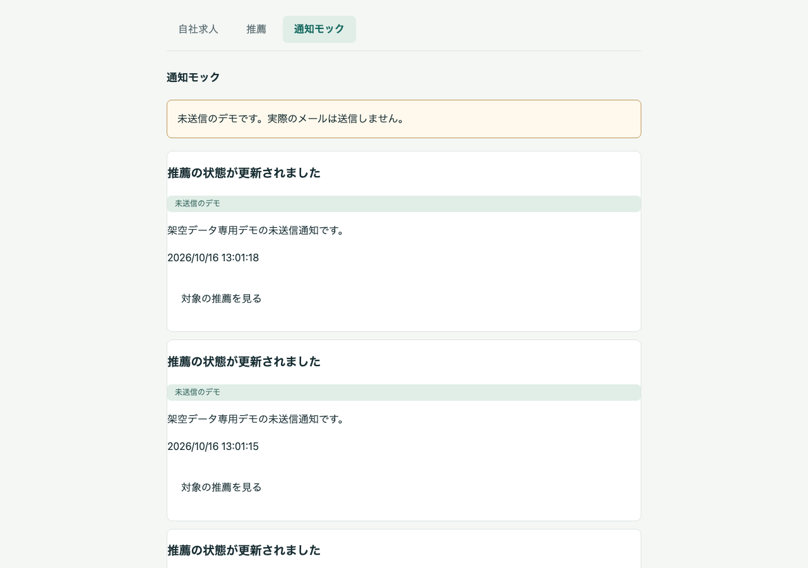
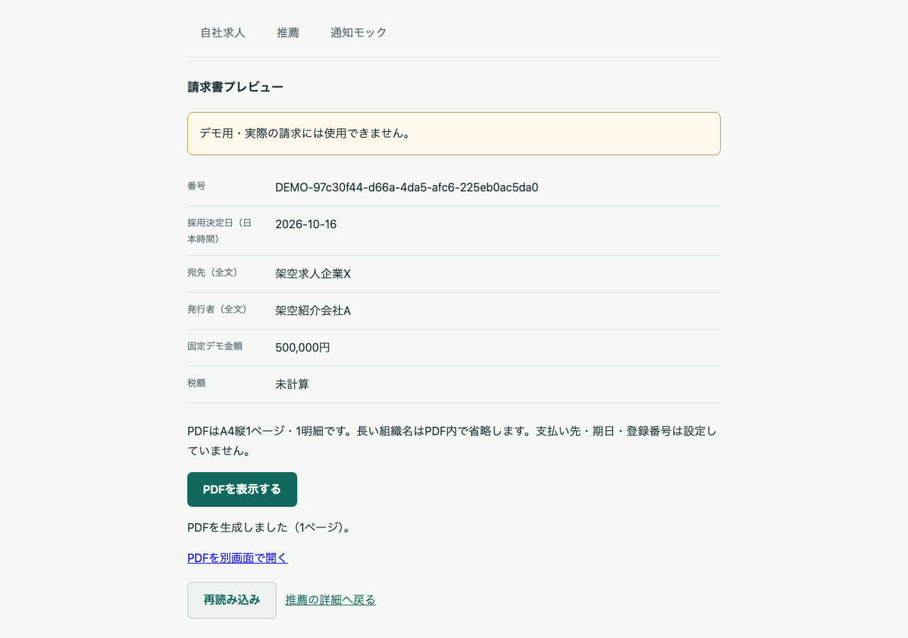
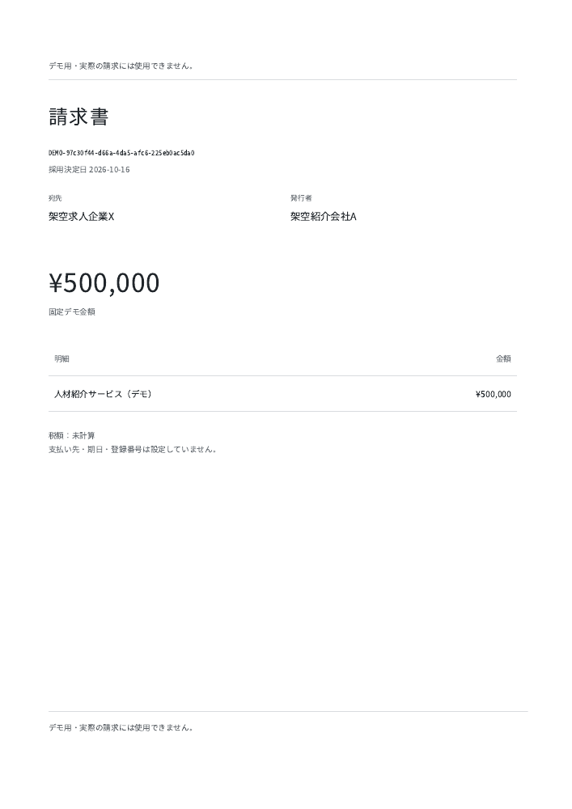

# 採用決定から通知・請求プレビューまで：M5のPCデモ

2026-10-16。架空データ専用のプロトタイプです。**求人登録から採用決定、請求書PDF表示までをブラウザで一巡できる状態になりました。**

[求人・候補者・書類・推薦・選考の操作ガイド（R4時点の13枚）](../2026-10-16-pc/README.md)に続くM5の画面です。以下はM5のE2Eで別の架空案件を登録し、採用まで一巡して撮影した実画面です。過去13枚の案件から生成したPDFではありません。

## 1. 状態変更の通知を確認

「通知モック」で、自組織宛ての状態変更の通知予定を確認できます。「未送信のデモ」と表示し、実メールは送信しません。候補者の氏名・経歴を通知本文に入れません。

## 2. 採用決定から請求プレビューへ

求人企業の「採用を決定する」で採用記録が作成され、推薦詳細に「請求書プレビューを開く」が表示されます。宛先・発行者・採用決定日・固定額を確認し、「PDFを表示する」を押します。

## 3. 固定1ページのデモPDF

PDFはA4縦1ページ・1明細・固定500,000円です。税額は未計算で、実際の請求には使用できません。支払い先・期日・登録番号、候補者の氏名や経歴は載せません。

[デモPDFを開く](m5-invoice.pdf)

以下は生成した原本PDFをPNGへ描画したものです。ブラウザ画像への合成や画面の作り替えはしていません。

## 確認したことと制約

- macOS/arm64、隔離URL `http://localhost:3001/`、Playwright Chromium、PC 1280×900。Browser plugin not available。
- 実認証、実形式/AV検査、登録・推薦・選考・採用・PDF生成を使用。API/AV合格のモック注入なし。
- 他組織・採用前は請求表示を拒否。企業の共有失効/認証失効後は表示を消し、再取得を拒否。紹介会社は採用後の共有取消でも自社請求プレビューを確認できます。
- PDFサービス停止時はエラーを表示し、復旧後に再試行できます。
- 通知モックは送信機能ではありません。実請求・決済・クラウドサイン連携・通信断中の端末保存・外部公開は未実装です。
- 通常デモ3000は旧M4環境のままです。今回の撮影は隔離環境で行い、終了後に停止しています。

[検証結果・残工数・公開前の確認](../../validation/2026-10-16-m5-report.md) / [リポジトリの入口](../../../README.md)
