# 求人・紹介業務のプロトタイプ：PC版操作ガイド

2026-10-16 / R4までの実装を使った、架空データだけのデモです。

**求人を登録し、候補者の書類を添えて推薦し、求人企業が選考・採用を決めるところまで操作できます。** 入力を中断したときの下書き復元と、企業への共有を取り消す動きも紹介します。

実際のブラウザ操作で撮影した13枚を、業務の順番に並べています。画面の作り替えや合成はしていません。操作内容を見やすくするため、PC画面を該当箇所までスクロールして撮影しています。推薦提出・選考・採用の3枚は、同じPC画面の業務領域全体をブラウザで直接撮影し、下にある操作ボタンまで含めています。

## 今回見られる範囲

| 機能 | 現段階 |
| --- | --- |
| 求人企業・紹介会社の認証/所属 | 実装済み。今回は求人企業X、紹介会社A、アクセス拒否の紹介会社Bで操作 |
| 求人登録・公開・検索 | 実装済み |
| 候補者登録・書類添付 | PDF/XLSX原本、形式検査と実ウイルス検査、種類/版の表示まで実装済み |
| 推薦・共有内容の確認・選考・採用決定 | 実装済み |
| 下書き自動保存・復元 | サーバー保存成功分を復元。確認チェックは再確認が必要 |
| 共有取消・他組織からの拒否 | 実装済み。取得済み書類の回収はできない |
| 通信断中の端末保存・同期 | 未実装（R5以降） |
| メール送信・通知画面・請求PDFプレビュー | 現在は未実装。今回の流れに含めない |
| クラウドサイン | [導入方法の設計](../../design/11-cloudsign.md)のみ。契約送信・署名はしていない |

## 操作の流れ

### 1. 紹介会社としてログイン

紹介会社Aのアカウントで業務画面へ進みます。所属組織と利用区分が表示され、求人・候補者・推薦へ移動できます。ID/パスワードの入力画面や認証情報は撮影していません。

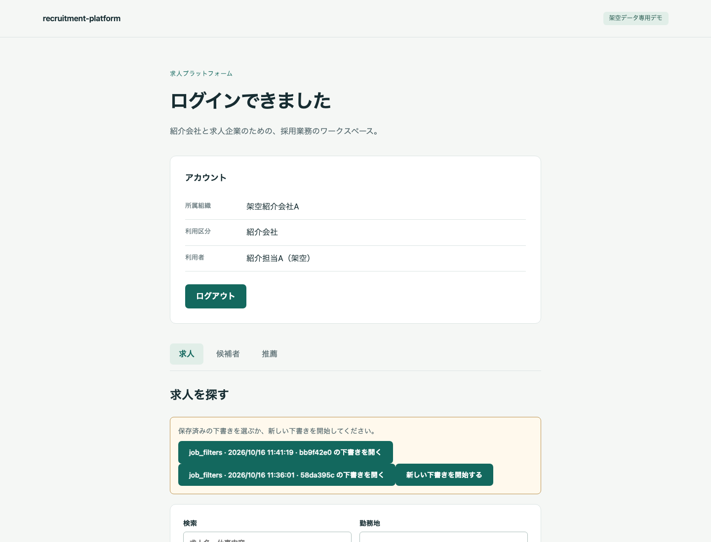

### 2. 求人企業が求人を入力

求人企業Xで、求人名・仕事内容・勤務地を入力します。「個人下書き」の保存状態が表示されます。入力中の自動保存と、業務上の求人登録/公開は別の操作です。

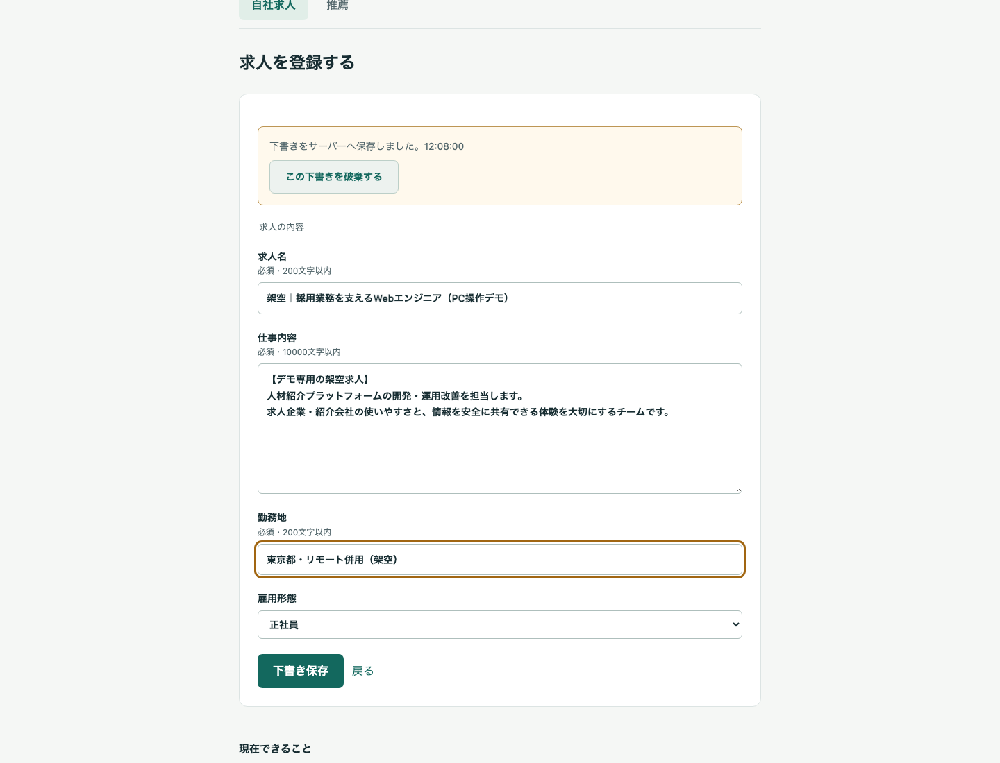

### 3. 求人を公開

求人を登録してから「公開する」を実行します。紹介会社が検索できる求人になります。

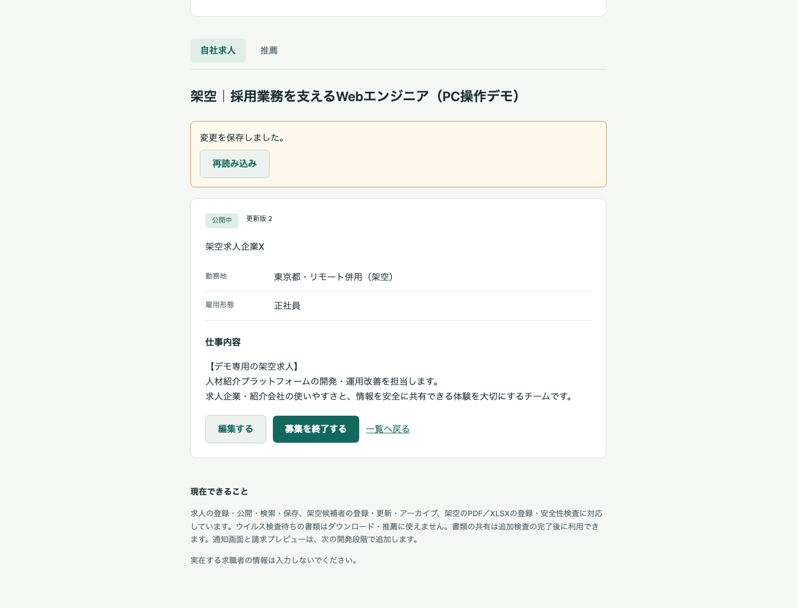

### 4. 紹介会社が求人を検索

紹介会社Aへ戻り、公開した求人名で検索します。求人の詳細から、その求人への推薦を作れます。

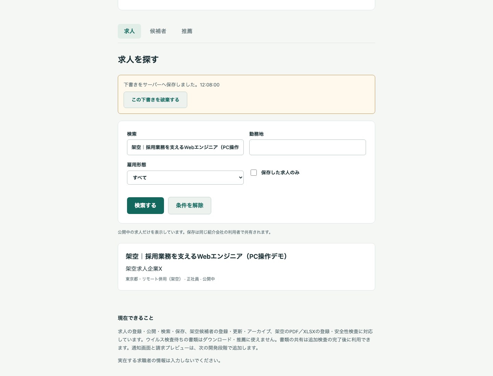

### 5. 候補者の入力途中を自動保存

氏名と経歴の概要を入力すると、個人下書きとしてサーバーに保存されます。電話や別画面で作業を中断する前に、保存表示で状態を確認できます。この段階では候補者の登録はまだ確定していません。

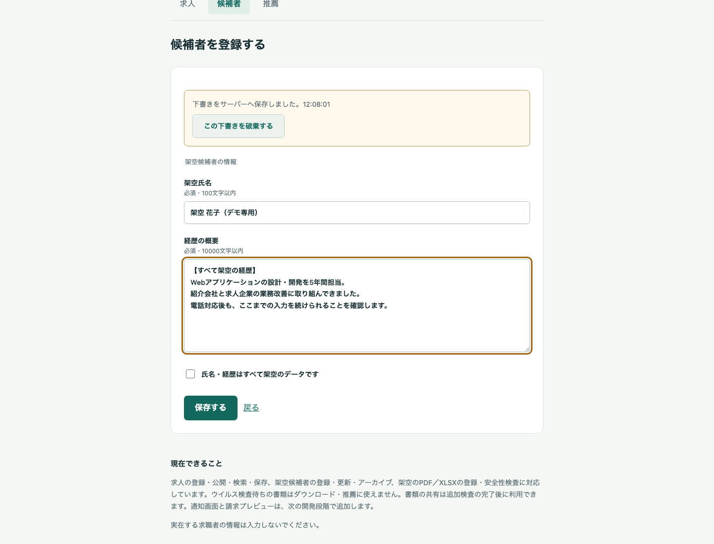

### 6. 画面を再表示して入力を復元

ページを再読み込みし、保存した入力が戻ることを確認しました。複数の下書きがある場合は本人が選びます。架空データの確認チェックは復元せず、もう一度確認してから「保存する」で候補者登録を確定します。

最後の未同期入力や通信断中の保存を保証する画面ではありません。未送信ファイルは再選択が必要です。

### 7. 履歴書PDF・職務経歴書XLSXを登録

書類種類を指定し、PDFの履歴書とXLSXの職務経歴書をそれぞれ登録しました。どちらも形式検査と実ウイルス検査を通した原本です。画面で種類・版・形式・ファイル名を確認できます。検査が終わらない書類は、推薦/ダウンロードに使えません。

XLSXはGoogleスプレッドシート実出力の架空fixtureを使用しています。Excel実出力は互換性未確認で、XLSXのブラウザ内プレビュー/変換はありません。画像は書類の登録一覧です。

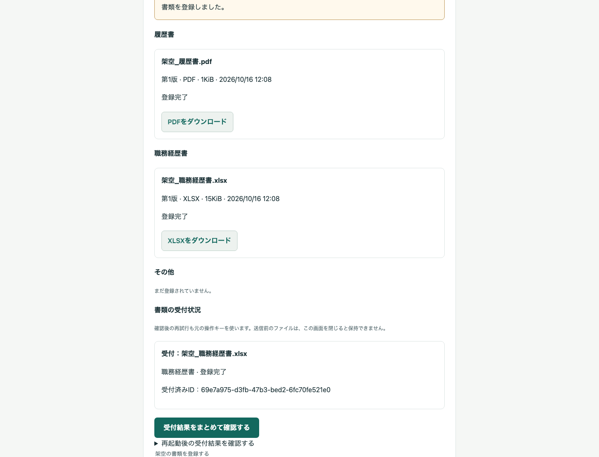

### 8. 推薦内容と共有する書類を確認

求人詳細から候補者と推薦理由を指定して、推薦の下書きを作成します。その後、企業へ共有する候補者情報・推薦理由と、提出する書類の種類/版を確認し、共有する書類だけを明示選択します。この撮影では2点とも選びました。

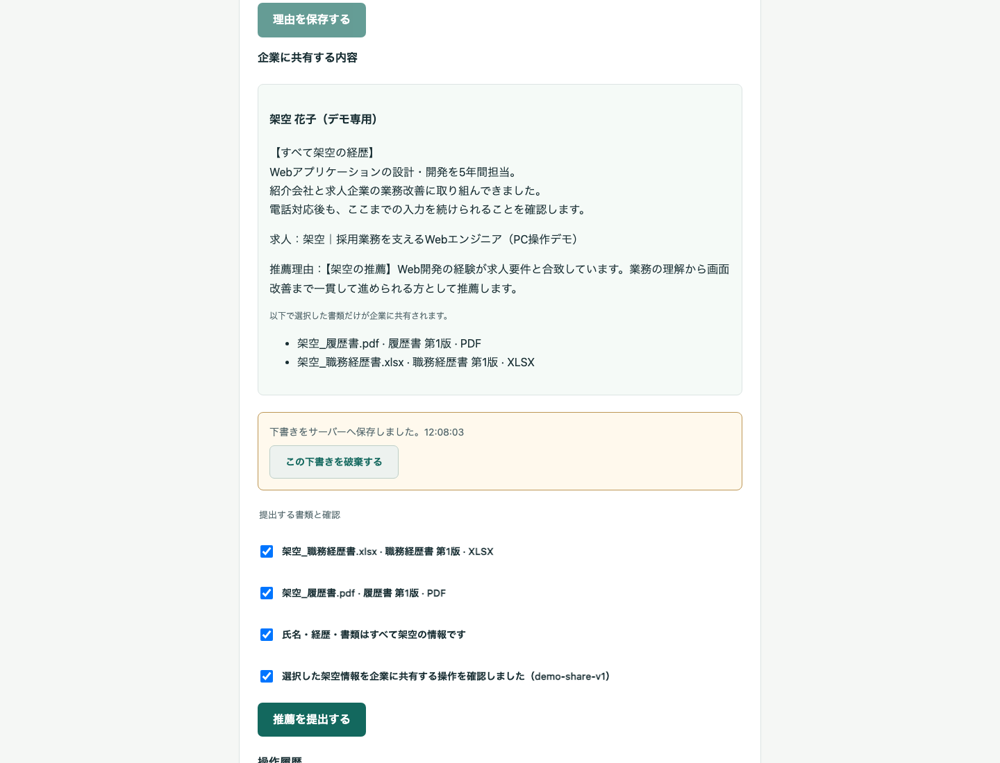

### 9. 推薦を提出

確認チェックを行って提出します。求人・候補者情報と選択した書類の参照を提出時点で固定し、以後の元データ編集とは分けて扱います。推薦の下書き段階では企業へ候補者を公開しません。

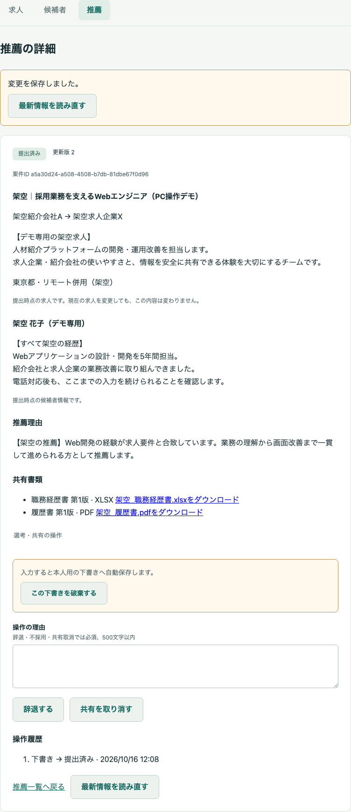

### 10. 求人企業が選考を開始

求人企業Xが、提出された候補者・推薦理由・共有書類を確認し、「選考を開始する」を実行します。「選考中」へ変わります。

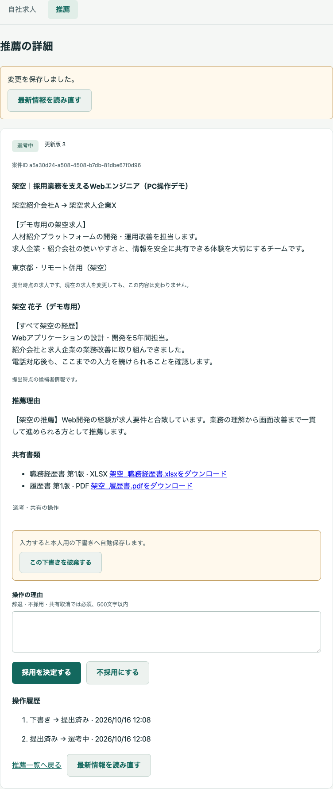

### 11. 採用を決定

求人企業Xで「採用を決定する」を実行し、採用記録を作成します。**ここが現段階の業務フローの到達点です。** 請求プレビューはまだなく、実際の雇用契約やクラウドサインの締結も行いません。

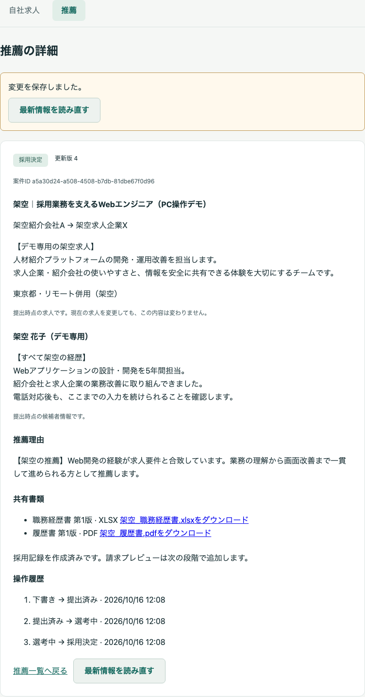

### 12. 紹介会社が共有を取り消した後の企業画面

採用後、紹介会社Aで理由を入力し、確認のうえ共有を取り消しました。求人企業Xの画面を再読み込みすると、候補者情報・書類・自由記入理由の表示がなくなります。採用記録は維持されます。既に取得済みの原本を回収する機能ではありません。

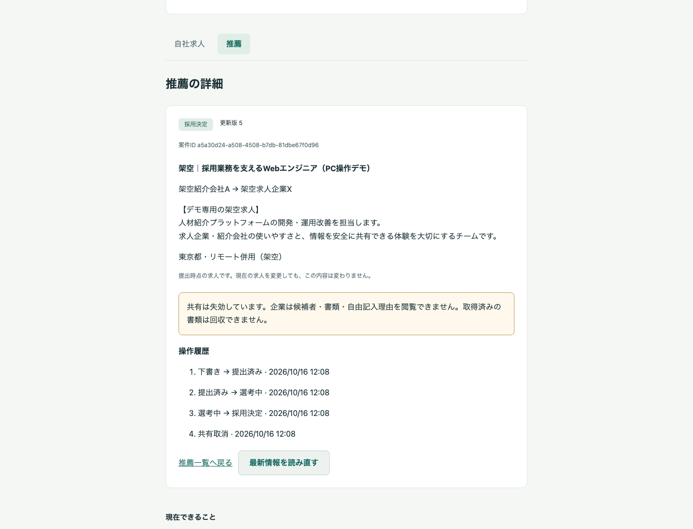

### 13. 別の紹介会社は候補者を閲覧できない

紹介会社Bで同じ候補者詳細URLを開くと、閲覧できない案内になります。氏名や経歴は表示されません。

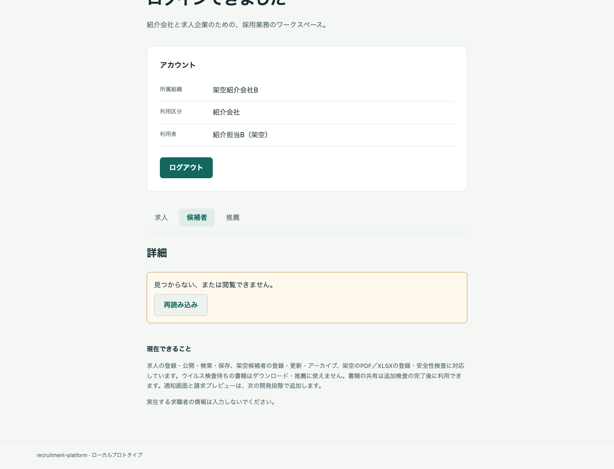

## 撮影と検証の記録

| 項目 | 内容 |
| --- | --- |
| 日付・範囲 | 2026-10-16。PCの上記一巡を今回実行して撮影 |
| 対象ソース | `d0feb10`（R4記録完了時点）。実行コードは両arch受入済みの`b8e7c8f`から変更なし |
| 環境 | macOS/arm64、隔離Compose環境 `http://localhost:3001/`、Playwright Chromium |
| PC画面 | 1440×1100、倍率1。一部は業務領域全体の撮影、今回モバイルは対象外 |
| ブラウザ経路 | Browser plugin not available。既存Playwrightを使用 |
| 実処理 | 認証・登録・自動保存/復元・実AV/形式検査・推薦・選考・共有取消・組織分離。APIモック/AV合格の注入なし |
| 画面チェック | タイトル/実内容/横はみ出し/フレームワークoverlay、状態の変化、console/pageerrorを確認。期待した他組織404は正常な拒否として区別 |
| 証拠 | [撮影結果JSON](capture.json)、[R4全体の受入記録](../../validation/2026-10-16-r4-report.md) |

今回の撮影は、R4の全88件を再実行したものではありません。両archの全E2E結果はR4記録を参照してください。今回の一巡で、登録から採用決定、共有失効、別組織拒否までの実際の画面と動きを追加確認しました。最初の撮影は共有失効の期待文言が旧表現で止まったため、実際の表示に合わせた待機条件で一巡をやり直しました。検索結果の切替完了待ちと、選考ボタンまで見える撮影範囲も確認して撮り直しました。製品コードや拒否条件は変更していません。

撮影用にR4の既存隔離DBを再利用して架空の求人・候補者・書類を追加しました。以前の記録/データは保持し、終了後はこの隔離環境だけを停止しました。通常デモ`localhost:3000`のコード/DBは更新していません。写真にはパスワード、token、cookie、原本の個人情報を含めていません。

[リポジトリの入口](../../../README.md) / [設計の入口](../../design/README.md)

### 今回の画面チェック

| チェック | 結果 |
| --- | --- |
| ページ識別・実内容 | 合格 |
| framework overlay・横はみ出し | なし |
| 想定外console警告/エラー・pageerror | なし |
| 操作後の状態変化と画像 | 13場面を確認 |
| 認証情報の写り込み/文書内秘密値 | 検出なし |
| 終了状態 | 隔離9サービス停止、通常デモ7サービスhealthy/HTTP 200 |
