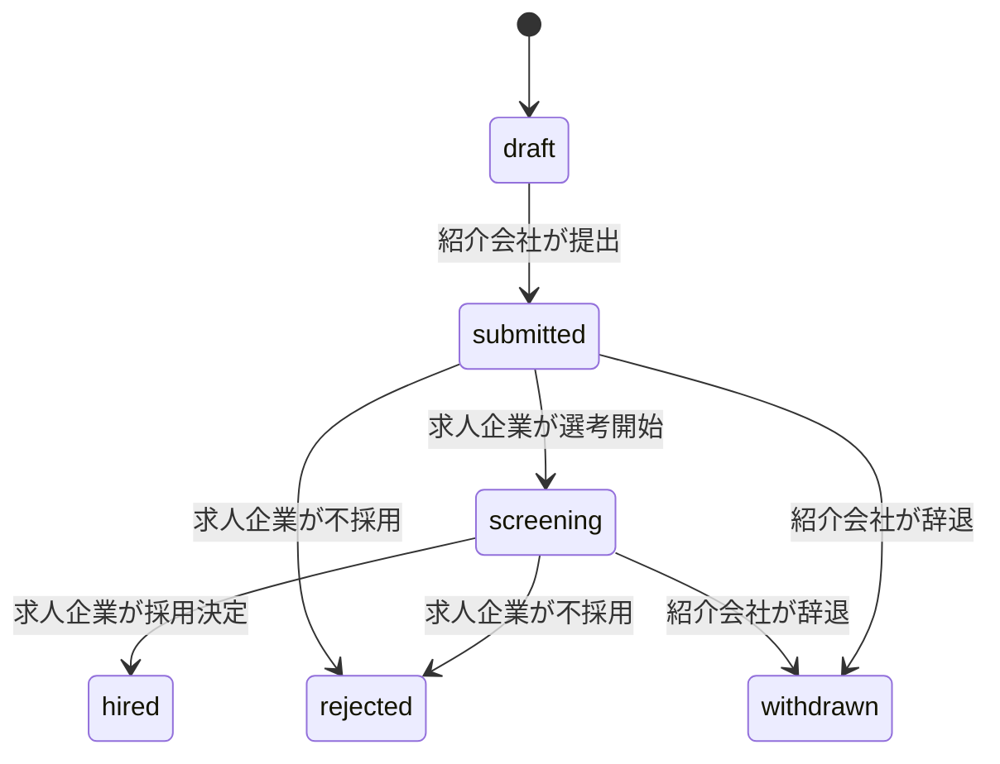

# 画面とデモシナリオ

## 共通の画面構成

左にナビゲーション、上部に組織名・利用者名・ログアウト、本文にページタイトルと主操作を配置する。紹介会社は「求人」「候補者」「推薦」「通知」、求人企業は「自社求人」「推薦」「通知」。常に「架空データ専用デモ」の表示を出す。所属は1ユーザー1組織に固定し、組織切替UIを置かない。別の組織は別アカウントでログインする。

デスクトップで一覧と詳細を読みやすくし、狭い画面では表をカードまたは横スクロールにする。主要操作は日本語の動詞で表す。装飾より、現在の状態と次にできる操作を優先する。

## 画面契約

| パス | 主な利用者 | 表示・操作 |
| --- | --- | --- |
| /login | 全員 | OIDCログインへの入口、デモ利用上の説明 |
| /jobs | 紹介会社 | 検索、勤務地・雇用形態・保存の絞込み、公開求人のみ |
| /jobs/new /jobs/:id/edit | 求人企業 | タイトル・説明・勤務地・雇用形態の入力、下書き保存・公開 |
| /jobs/:id | 両方 | 求人詳細。紹介会社は保存・推薦、企業は自社求人の募集終了 |
| /candidates /candidates/new | 紹介会社 | 自社候補者一覧、登録。企業側には画面を出さない |
| /candidates/:id | 紹介会社 | 架空氏名・概要・PDF一覧。更新・PDF登録（処理中/完了/拒否と理由）・アーカイブ |
| /applications/new?job_id=:id | 紹介会社 | 自社候補者、推薦理由、共有PDF、同意確認を選び下書き |
| /applications /applications/:id | 両方 | 関係する推薦のみ。状態、共有情報、操作履歴、次の操作 |
| /applications/:id/invoice | 両方 | 採用決定後のデモ金額、PDF表示ボタン |
| /notifications | 両方 | 自組織宛ての通知モック。「外部には送信していません」 |

企業用求人一覧は /jobs の組織種別で自社求人一覧に切り替える。下書きに保存するのは候補者ID・求人ID・推薦理由。PDFの選択は提出時に確認し、下書きを再び開いた場合は選び直す。提出前の推薦画面では「企業に共有される内容」をプレビューし、氏名・概要・選んだPDFを具体的に表示する。

## 状態と操作

表示名は下書き・提出済み・選考中・不採用・採用決定・辞退。企業は下書きを閲覧できない。終端状態からの復帰は扱わず、rejected/withdrawn後の再推薦は新しい案件を作る。hired後は同じ候補者/求人への再推薦を許可しない。辞退後は企業から候補者のスナップショットとPDFへのアクセスを止め、案件ID・提出時点の求人・状態/時刻の履歴だけを残す。企業の共有PDF取得はE_SHAREDに従い、辞退時はshare_revoked_atも同じtransactionで設定する。

## デモの順序

1. 企業Xでログインして架空求人を公開する。
2. ログアウトし、紹介会社Aでログイン。求人検索と保存を試す。
3. 候補者を登録し、同梱のサンプルPDFをアップロードする。
4. 共有内容を確認し推薦を提出する。通知モックを確認する。
5. 紹介会社Aをログアウトし企業Xでログイン、推薦PDFを確認し、選考開始→採用決定と進める。
6. 請求書PDFを開き、デモ専用の表示・日本語・固定1ページであることを確認する。
7. BまたはYの別browser contextで同じURLを開き、閲覧できないことを確認する。

## 必要な失敗・空状態

検索0件は条件を解除できる。候補者0件は登録へ案内。PDF不正・容量超過はreadyとして保管せず理由を表示。処理中は状態URLを確認し、同じキーの再試行で別文書を作らない。ログイン期限切れは遷移前までフォームを画面内に保持し、「再ログイン後は再入力が必要」と案内する。OIDCへの遷移後の復元は保証せず、個人情報をlocalStorageへ置かない。

二重クリック中はボタンを無効化し、タイムアウト時は案件一覧で結果を確認できる。409競合は最新情報を読み直して再判断を求め、入力内容を自動で上書きしない。認可対象外は「見つからない、または閲覧できません」と表示する。

フォームにlabelとエラー説明を付け、キーボード・フォーカス・読み上げで使えることを確認する。色だけで状態を示さず、文字拡大、動きの低減、日本語の長い求人名でも操作が隠れないようにする。

## 共有撤回の操作

紹介会社の推薦詳細に「共有を取り消す」を置く。下書きには出さない。提出済み/選考中では「辞退として確定し、企業の候補者・PDF閲覧を止めます」と確認する。不採用/採用決定後では選考状態を変えず共有だけを止める。採用記録は維持される。撤回後は再共有できないこと、取得済みPDFを回収できないことを示す。

請求プレビューのPDFは固定1ページ。省略された組織名の全文は画面で確認できる。共有失効後は企業側のPDFボタンを消し、保存済みURLへの直接要求も拒否する。
