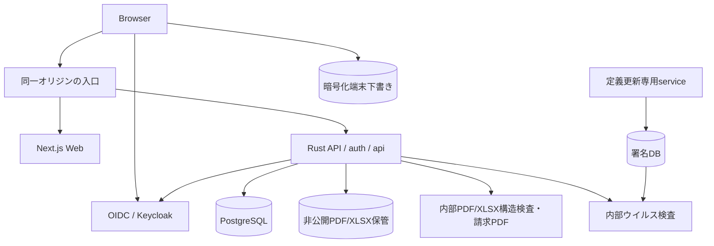

# アーキテクチャと実装配置

> **2026-10-16：現行構成への案内**
> 署名付き暗号化受付・隔離ワーカー・安全な閲覧はS1〜S3で実装済み。S4の移行・復旧は[S4記録](../validation/2026-10-16-s4-report.md)、S5の両arch横断受入は[S5記録](../validation/2026-10-16-s5-report.md)、R5の端末保存・復元は[R5記録](../validation/2026-10-17-r5-report.md)を参照。以下の構成図・同居するPDF検査／請求・LocalBlobStoreの説明は旧構成の履歴であり、現行の文書保護経路を表さない。現行契約は[正本設計](12-secure-document-pipeline.md)、[S2](14-s2-worker-contract.md)、[S3](15-s3-safe-view-contract.md)、[S4](16-s4-migration-contract.md)を優先する。

## 現行の責務と言語

| 部分 | 実装と責務 |
| --- | --- |
| Web | Next.js / TypeScript（strict）。画面・フォーム・暗号化受付・安全な閲覧 |
| 業務API | Rust / Axum / SQLx。認証・認可・取引・保管制御 |
| 文書ワーカー | Node.js CJSのbroker／relay／viewer／crypto、Python sandbox。隔離検査と成果物生成・暗号化 |
| 請求 | APIの認可済みデータからHTMLプレビュー。旧請求PDF配信は閉鎖 |

現状はサービス責務と機能別モジュールを分けた構成。RustのHTTP・業務判断・SQLには結合があり、domain/usecaseとadapterの依存逆転を徹底した厳密なClean Architectureではない。本体Node CJSは構文検査と実行時検証・E2Eを持つが、TypeScriptの型検査対象外である。境界DTOの型・実行時検証の整合と、変更する業務規則の分離は保守上の改善対象。全面TS化・全面再編はS4の範囲に追加しない。

## 選ぶ構成

Web画面はNext.js / TypeScript、業務APIはRust / Axum / SQLx、永続化はPostgreSQLを使う。業務ロジックはRustの1プロセス内のモジュールにまとめる。初期版はDocker Composeでローカル起動できることを優先する。

認証はOIDC、ローカルの認証基盤はKeycloak。PDF/XLSXレジュメはAPIだけが読み書きする専用ディレクトリに保存し、クラウド例ではオブジェクトストレージへ置き換える。内部PDF serviceは、pikepdf/libqpdfによるPDF検査・隔離したXLSX構造検査と、Playwright/Chromiumでの固定1ページの請求PDF生成を担当する。両処理を1サービスへまとめ、DBと保管volumeは渡さない。



## ローカル起動の契約

M4のComposeは入口、Web、API、アプリDB、OIDC、OIDC用DB、PDFレンダラーの7サービスを起動する。R2は内部AV scannerと定義更新serviceを加えた9サービスを実装する。scannerはAPI専用の内部network、updaterは別の外向きnetworkでDB/原本から分離する。ブラウザに公開するのは入口とOIDCのログイン先だけ。DB、保存ファイル、PDFレンダラーは外部ポートを公開しない。OIDCの管理コンソールはローカルに限定する。

M1の通常デモは入口3000/IdP18080、E2Eは毎回新しいCompose projectと設定/DB、既定で3001/18082を使う。portは1024〜65535の異なる値に限定し、APP_ORIGINのlocalhostとissuerのidp.recruitment.localhost以外は受け付けない。realm/redirect/コンテナ側HTTP portも同じ設定から生成する。テストは専用の新しいブラウザcontextを使い、既存デモのcookieを共有しない。

M0で確認したローカルissuerの経路は、ブラウザ側の*.localhostと、コンテナ側の同名network aliasを組み合わせる。ブラウザ向けとAPI向けで別issuerへ読み替えない。PDF serviceは非root、必要なSYS_CHROOTのみ、公式seccomp profile、tmpfs内HOME/XDGでChromium sandboxを維持する。M0検証用コードはvalidation/m0に置き、製品の認証・保存・文書サービスへそのまま流用しない。

M1の起動は設定作成→ローカル秘密値生成→基礎service起動→migration/架空データ投入→API/Web build/up→ログインの順序。確認済みコマンドはREADMEへ掲載する。初期データ投入は冪等にし、ユーザーのデータを初期化し直さない。データリセットは別コマンドで対象と不可逆性を示し、明示確認が必要。

## 責務

| 部分 | 担当 |
| --- | --- |
| Web | 表示、全フォーム下書きの暗号化端末保存/同期/復元、検索条件、PDF表示。業務上の認可判断はAPIの結果に従う |
| API | OIDC、セッション、認可、DBトランザクション、ファイル取得、PDF生成依頼 |
| DB | 組織分離RLS、参照整合性、一意制約、推薦履歴、通知モック、本人の暗号化フォーム下書き/検査記録 |
| BlobStore | 保存・取得・整合確認。初期実装はLocalBlobStoreのみ。後続のcloud adaptersをこの契約へ閉じる |
| PDF service | PDF/XLSX bytesの制限付き構造検査と、固定schemaの請求PDF生成。任意HTML・URLを受け付けない |
| Scan / updater | scanは隔離したbytes検査のみ。updaterだけ署名更新の外向き通信を持ち、原本/DBを扱わない |

APIは同一オリジンに配置する。Webがサーバー側でAPIを呼ぶ場合は必要なセッションcookieを明示的に引き継ぎ、応答を共有キャッシュへ置かない。ブラウザにOIDCトークンを保管させない。

## 文書と非同期処理

請求プレビューはAPIが認可済みデータを内部レンダラーへ渡し、PDF bytesを返す。内部共有鍵と内部ネットワークで制限する。レンダラーは固定テンプレートをHTMLエスケープし、外部通信を止め、日本語フォントを同梱する。10秒で失敗を返し、利用者が再試行できるようにする。請求生成の同時実行は初期2件、検査は1件、上限超過は503とする。検査とアップロードの復旧契約は[安全性設計](06-security.md)に従い、PDF serviceは保存先を直接操作しない。v0.4ではAV→形式検査を必須とし、120秒lease/利用可否照合を追加する。scan/updaterの権限・通信・更新障害の境界は[追加契約](10-resumes-and-autosave.md#4-ウイルス検査と隔離)に従う。

通知モックは推薦変更と同一トランザクションでDBへ追加する。外部送信ジョブは存在しない。クラウドの常駐バックグラウンド処理に依存せず一巡できる。

## 実装予定の配置

以下は全体の配置図。M1は認証に必要なapps/web、services/api、migrations、fixtures、infra/local、scriptsを実装済み。M2で求人・候補者、M3でPDF登録・検査・復旧・原本配信、M4で推薦・選考・snapshot/共有失効を追加する。請求PDF生成とクラウド例は後続段階。

```text
apps/web/                  Next.js UI
services/api/              Rust API、domain、認可、DBアクセス
services/pdf-renderer/     内部PDF/XLSX構造検査、Chromium、請求テンプレート
services/av/               実clamdの認証付きwrapper、FreshClam、世代manifest
services/document-scanner/  AV wrapper/clamd、定義更新（v0.4の予定、未作成）
migrations/                SQL、RLS、制約
fixtures/                  架空データ、サンプルPDF
infra/local/               Compose、入口、OIDC初期設定
examples/terraform/aws/    AWS参照例
examples/terraform/gcp/    GCP参照例
examples/terraform/azure/  Azure参照例
docs/                      設計、使い方、ガイド
```

## 依存の確定方法

実装開始時にサポート対象のNode、Next.js、Rust、Axum、SQLx、PostgreSQL、Keycloak、Playwright、Python、pikepdf/libqpdfを一次資料で確認し、バージョンとlockfileを固定する。latestタグを配布手順に使わない。DB migration用の権限と通常API用の権限を分ける。依存とフォントのライセンスを一覧にし、配布するイメージの脆弱性を確認する。

参照：[Axum](https://docs.rs/axum/latest/axum/)、[Next.js self-hosting](https://nextjs.org/docs/app/guides/self-hosting)、[Keycloak container](https://www.keycloak.org/server/containers)、[Playwright PDF](https://playwright.dev/docs/api/class-page#page-pdf)。これらを用いた上記構成は本プロジェクトの設計判断であり、M1の実装範囲と実行結果は[確認記録](../validation/2026-10-15-m1-report.md)を参照。未実装部分の成立を保証しない。

## R5の端末保存境界

ブラウザ側の`local-drafts.ts`が暗号化IndexedDB・tab排他・終了marker、`drafts.tsx`が認証済みAPIとの同期・復元選択を担当する。業務確定は端末送信予定の永続化後に要求し、結果照合は既存のサーバー台帳を正本とする。Reactの認証再照合gateで表示・復号・同期・送信を停止する。製品実装・制約・検証範囲は[実装契約](18-r5-device-drafts.md)を優先する。
