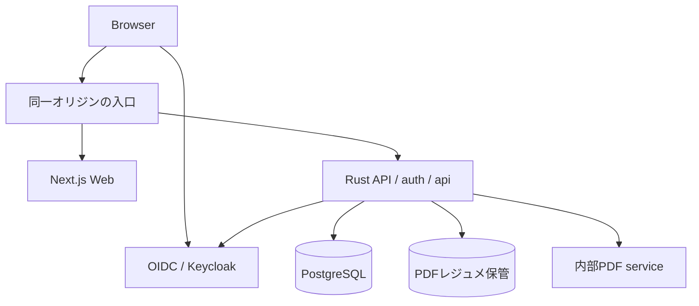

# アーキテクチャと実装配置

## 選ぶ構成

Web画面はNext.js / TypeScript、業務APIはRust / Axum / SQLx、永続化はPostgreSQLを使う。業務ロジックはRustの1プロセス内のモジュールにまとめる。初期版はDocker Composeでローカル起動できることを優先する。

認証はOIDC、ローカルの認証基盤はKeycloak。レジュメはAPIだけが読み書きする専用ディレクトリに保存し、クラウド例ではオブジェクトストレージへ置き換える。内部PDF serviceは、pikepdf/libqpdfでのレジュメ検査と、Playwright/Chromiumでの固定1ページの請求PDF生成を担当する。両処理を1サービスへまとめ、DBと保管volumeは渡さない。



## ローカル起動の契約

Composeは入口、Web、API、アプリDB、OIDC、OIDC用DB、PDFレンダラーを起動する。ブラウザに公開するのは入口とOIDCのログイン先だけ。DB、保存ファイル、PDFレンダラーは外部ポートを公開しない。OIDCの管理コンソールはローカルに限定する。

M1の通常デモは入口3000/IdP18080、E2Eは毎回新しいCompose projectと設定/DB、既定で3001/18082を使う。portは1024〜65535の異なる値に限定し、APP_ORIGINのlocalhostとissuerのidp.recruitment.localhost以外は受け付けない。realm/redirect/コンテナ側HTTP portも同じ設定から生成する。テストは専用の新しいブラウザcontextを使い、既存デモのcookieを共有しない。

M0で確認したローカルissuerの経路は、ブラウザ側の*.localhostと、コンテナ側の同名network aliasを組み合わせる。ブラウザ向けとAPI向けで別issuerへ読み替えない。PDF serviceは非root、必要なSYS_CHROOTのみ、公式seccomp profile、tmpfs内HOME/XDGでChromium sandboxを維持する。M0検証用コードはvalidation/m0に置き、製品の認証・保存・文書サービスへそのまま流用しない。

M1の起動は設定作成→ローカル秘密値生成→基礎service起動→migration/架空データ投入→API/Web build/up→ログインの順序。確認済みコマンドはREADMEへ掲載する。初期データ投入は冪等にし、ユーザーのデータを初期化し直さない。データリセットは別コマンドで対象と不可逆性を示し、明示確認が必要。

## 責務

| 部分 | 担当 |
| --- | --- |
| Web | 表示、フォーム、検索条件、PDF表示。業務上の認可判断はAPIの結果に従う |
| API | OIDC、セッション、認可、DBトランザクション、ファイル取得、PDF生成依頼 |
| DB | 組織分離RLS、参照整合性、一意制約、推薦履歴、通知モック |
| BlobStore | 保存・取得・整合確認。初期実装はLocalBlobStoreのみ。後続のcloud adaptersをこの契約へ閉じる |
| PDF service | bytesの制限付き検査と、固定schemaの請求PDF生成。任意HTML・URLを受け付けない |

APIは同一オリジンに配置する。Webがサーバー側でAPIを呼ぶ場合は必要なセッションcookieを明示的に引き継ぎ、応答を共有キャッシュへ置かない。ブラウザにOIDCトークンを保管させない。

## PDFと非同期処理

請求プレビューはAPIが認可済みデータを内部レンダラーへ渡し、PDF bytesを返す。内部共有鍵と内部ネットワークで制限する。レンダラーは固定テンプレートをHTMLエスケープし、外部通信を止め、日本語フォントを同梱する。10秒で失敗を返し、利用者が再試行できるようにする。請求生成の同時実行は初期2件、検査は1件、上限超過は503とする。検査とアップロードの復旧契約は[安全性設計](06-security.md)に従い、PDF serviceは保存先を直接操作しない。

通知モックは推薦変更と同一トランザクションでDBへ追加する。外部送信ジョブは存在しない。クラウドの常駐バックグラウンド処理に依存せず一巡できる。

## 実装予定の配置

以下は全体の配置図。M1は認証に必要なapps/web、services/api、migrations、fixtures、infra/local、scriptsを実装済み。M2で求人・候補者、M3でPDF登録・検査・復旧・原本配信、M4で推薦・選考・snapshot/共有失効を追加する。請求PDF生成とクラウド例は後続段階。

```text
apps/web/                  Next.js UI
services/api/              Rust API、domain、認可、DBアクセス
services/pdf-renderer/     内部PDF service（検査子process、Chromium、固定テンプレート、日本語フォント）
migrations/                SQL、RLS、制約
fixtures/                  架空データ、サンプルPDF
infra/local/               Compose、入口、OIDC初期設定
examples/terraform/aws/    AWS参照例
examples/terraform/gcp/    GCP参照例
examples/terraform/azure/  Azure参照例
docs/                      設計、使い方、ガイド
```

## 依存の確定方法

実装開始時にサポート対象のNode、Next.js、Rust、Axum、SQLx、PostgreSQL、Keycloak、Playwright、Python、pikepdf/libqpdfを一次資料で確認し、バージョンとlockfileを固定する。latestタグを配布手順に使わない。DB migration用の権限と通常API用の権限を分ける。依存とフォントのライセンスを一覧にし、配布するイメージの脆弱性を確認する。

参照：[Axum](https://docs.rs/axum/latest/axum/)、[Next.js self-hosting](https://nextjs.org/docs/app/guides/self-hosting)、[Keycloak container](https://www.keycloak.org/server/containers)、[Playwright PDF](https://playwright.dev/docs/api/class-page#page-pdf)。これらを用いた上記構成は本プロジェクトの設計判断であり、M1の実装範囲と実行結果は[確認記録](../validation/2026-10-15-m1-report.md)を参照。未実装部分の成立を保証しない。
