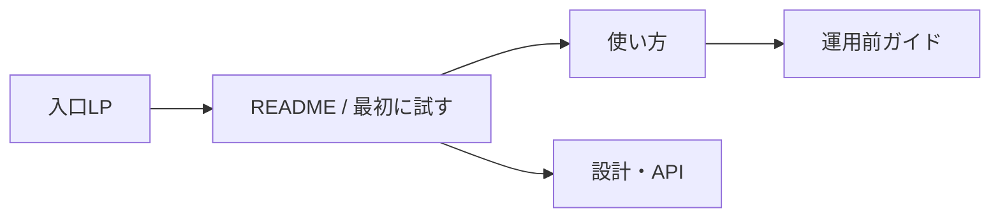

# LP・ガイド・利用文書の要件と目次

## 今回と次の段階

今回は文書の目的、読者、目次、掲載条件を設計する。LP本文、詳細ガイドの本文、ドキュメントサイトの実装は別の段階。ローカルプロトタイプの引渡しには、実装で確認した最小の起動・操作説明を含める。

## 読者と導線

初見の人はLPで何を試せるかを理解し、READMEからローカルで動かす。利用担当者は操作ガイドで一巡を試す。開発者は設計/APIを読み、運用を考える人は運用前ガイドで責任・確認事項を整理する。

## 入口LPの要件

| 順序 | セクション | 必要な内容・証拠 |
| --- | --- | --- |
| 1 | 何ができるか | 紹介会社と企業の間で推薦・選考を共有する、という一文 |
| 2 | 操作の一巡 | 実装済みの画面画像または動画。未実装UIを稼働中に見せない |
| 3 | 試す入口 | GitHubと確認済みクイックスタートへのリンク |
| 4 | 対象機能 | ログイン、求人、候補者、PDF、推薦、選考、通知モック、請求PDF |
| 5 | 利用の前提 | 架空データ専用・プロトタイプであること、外部請求・入金なし |
| 6 | 運用を考える人へ | 技術・個人情報・権限・復旧等のガイドへの入口 |
| 7 | 開発参加 | ライセンス、貢献手順、セキュリティ報告窓口 |

商用運用を考える人が自ら要件と責任を確認できる入口にする。誇張した工数・改善率、裏付けのない安全性、架空の導入実績を掲載しない。登録・問い合わせ・分析のための個人情報取得は初期LPに設けず、リンクで読める構成とする。

## 作る文書の目次

| 文書 | 目次・必要項目 | 掲載を始める条件 |
| --- | --- | --- |
| README | 機能、現在の状態、架空データ、最短起動、設計リンク、ライセンス | コマンドは実装・起動確認後 |
| Quickstart | prerequisites、設定生成、起動、migration、seed、login、停止、復旧、エラー | クリーンな環境で確認 |
| 使い方 | 紹介会社/企業のログイン、求人、候補者、PDF、推薦、選考、通知、請求PDF、辞退/共有撤回 | 画面と文言の一致 |
| 運用前ガイド | 事業上の役割、個人情報/同意、権限、保存/削除、バックアップ/restore、監視、障害、secret、費用、法務 | プロトタイプの限界と運用者の判断を明記 |
| 開発者ガイド | 構成、API、DB/RLS、認証、PDF、fixture、検証、依存更新 | source/設計/APIの整合 |
| クラウド例 | AWS/GCP/Azureの各構成、課金、plan/apply、検証/停止、未検証箇所 | 検証範囲を個別表示 |
| CONTRIBUTING | 環境、変更範囲、PR、受入、ライセンス、架空データルール | 実装開始前に最低限を作成 |
| SECURITY | 対象version、秘密を含まない報告、非公開の受付先、対応方針 | 受付先と担当者が実在し対応可能 |
| CHANGELOG | version、変更、migration/破壊的変更、既知制約 | リリース時 |

## 運用前ガイドの方針

実在の候補者情報を扱う前に、運営者・紹介会社・求人企業の役割と契約、情報提供の同意、第三者提供・委託の整理、問い合わせ・開示・削除、保存と復旧を確認する。技術上の認可の実装だけで法的な整理が済んだと扱わない。法令の説明には作成時点の一次資料と確認日を付ける。

参考：[厚生労働省の事業区分](https://www.mhlw.go.jp/stf/shoukaibosyuukubun.html)、[個人情報保護委員会の第三者提供FAQ](https://www.ppc.go.jp/all_faq_index/faq4-q301/)。ガイド本文作成時には改めて確認する。

## 文書サイトの設計方針

正本はGit内のMarkdown。サイトは同じファイルから生成し、同じ説明を二重管理しない。日本語を先に完成させる。versionを付け、未実装と実装済み・未検証と検証済みが読者に分かる表示にする。ツールは本文と情報構造の確定後に選ぶ。
