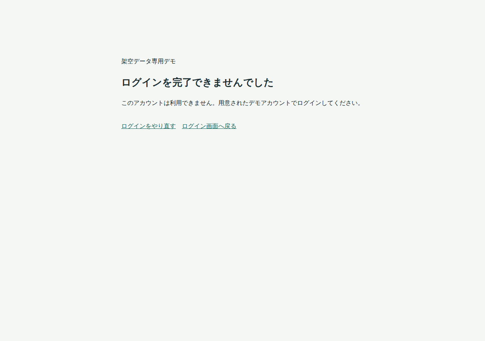
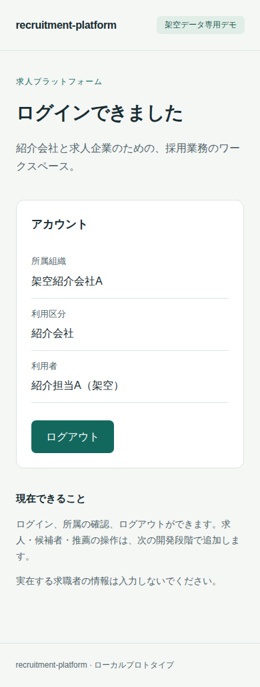

# M1不足修正とブラウザE2E

2026-10-15。**M1の認証基盤は、合意した対象範囲で実装と再実行可能なE2Eを完了した。** 対象はmacOS/Apple Silicon上のLinux arm64とLinux/amd64実機CI、およびPlaywright同梱Chromium。M2以降の求人・候補者・推薦・PDF製品処理は実装していない。

## 修正した不足

1. Gitから再実行できるテストがなかったため、Playwright Test 1.62.1、lockfile、隔離runner、手動CIを追加した。
2. 認証失敗時のブラウザにJSONが表示されていたため、HTTP 400/403/503を維持した静的な案内と再ログイン経路を追加した。JSON要求は共通error形式を維持し、不正queryも同じ形式へ正規化した。
3. 初回取得後の所属表示が古く残るため、focus/再表示/既知の期限でsessionを照合し、他タブlogoutで表示を消すよう修正した。処理中の/me応答をabortと世代番号で無効化し、古い応答で所属が復活しないことを確認する。
4. 通常環境を変更せずに無効化/期限変更を確認するため、loopback hostの制約を維持してport/Compose project/設定/DBを分離した。通常環境は3000/18080、E2Eは3001/18082と専用ブラウザcontextを使う。
5. ログイン制限の拒否を明確にするため429とRetry-Afterを返す。10回/分・burst 10は維持し、テストも待機して従う。

## 現在の確認

macOS/Apple SiliconのLinux arm64コンテナで、20件のE2Eが全件成功した。[実行証拠](2026-10-15-m1-e2e-local.json)にsource hash、各結果、実行時間、log検査、終了時のstopを記録した。Rust型検査、Next.js production buildも成功している。E2E専用依存のnpm auditは0件、RustSecは既存のrsa 0.9.10の1件で増加なし。詳細と使用経路は[依存一覧](../../THIRD_PARTY.md)を参照。

[Linux/amd64実機CI](https://github.com/mt4110/recruitment-platform/actions/runs/38682586308)も全20件が成功した。検証した実装/E2E commitは`901d245d30a0c5a9f9131694180060a76617e348`。その後の最終記録commitは文書・証拠・画面のみで、実装/E2Eソースは変更していない。

| 確認 | arm64ローカル | amd64 CI |
| --- | --- | --- |
| 全20件（skip/retryなし） | 成功 | 成功 |
| ソースhashと検証commitの一致 | 確認 | 確認 |
| 7サービスのログに生成秘密値/トークン形式がない | 確認 | 確認 |
| テスト専用サービスの終了時stop | 成功 | 成功 |
| runnerの経過時間（build/up/E2E/stop含む） | 137.975秒 | 358.485秒 |
| Docker | 29.5.2 / aarch64 | 28.0.4 / x86_64 |

CI jobは6分25秒。[CI証拠JSON](2026-10-15-m1-e2e-amd64.json)を回収し、ローカルと同じ20件・全件passed、ソースhash一致、clean checkout、ログ検査、stopを確認した。ログ検査は生成済み秘密値とトークン形式の照合であり、未知の漏えいを包括的に否定する検査ではない。経過時間を人の開発工数や性能保証には換算しない。

前段の初回実行では、テスト制御の作業ディレクトリ、Next.js通知領域とアプリ通知領域のselector重複、ログイン制限の待機不足を検出した。テスト側を修正してから全件を再実行し、失敗を成功扱いにしていない。

## 検証の範囲

実Keycloakでの4アカウント、同じブラウザでのA/B交代、固定所属とDB triggerの拒否、DB sessionとcookie、CSRF/Origin、未登録/無効user・組織、nonce・期限・verifier暗号文・browser bindingの異常、state/query不正、callback再利用、API再起動、期限切れ表示、別タブlogoutと遅延応答、通信失敗/再試行、キーボード・390px表示を確認する。

trace/動画/storageState/通信dump/失敗画面の自動保存はしない。env・realm・パスワード・build logはGit/CI artifactへ含めない。公開するのは許可した画面と、秘密値・URLを伏せたJSONだけ。8時間/5分の実経過待ちではなく、対象テスト行の期限を過去へ変更して失効を確認する。通信失敗/遅延だけをrouteで制御し、正常なOIDCはモックにしていない。

手順は[E2E README](../../e2e/README.md)。M1の認証回帰を前倒しで整備したもので、M6の業務全体のE2E/CIを完了扱いにしない。全ブラウザ、読み上げ、本番HTTPS、OS/image全体の監査は未実施。

## 判定と停止範囲

認証・唯一の所属・DB session/CSRF・架空fixture・7サービス起動と、再実行可能な認証E2EはM1として完了。通常デモのDB/資格情報を保全したまま修正を反映し、localhost:3000で起動している。入口設定もnginx reloadで反映した。テスト用container/volume/設定は削除せず保持する。

M2へは進まず、ここで停止する。既存WBSのM2〜M7は64〜112時間の計画幅を維持する。今回のM1限定E2EはM6の認証部分を前倒ししたが、業務全体の残作業を再積算した実測値ではない。既知のrsa指摘1件、全ブラウザ/読み上げ、本番HTTPS、OS/image監査などの未完事項は継続記録する。

## 画面の確認

ページidentity・非空表示・framework overlayなし・予期しないconsole/runtime例外なし・実操作をE2Eで確認。1280×900と390×844を使用し、CIのエラー案内と狭い画面を目視した。日本語に欠けや重なりは見つからなかった。OSのフォント差はあり、pixel一致は受入条件にしていない。

認証失敗時の再ログイン案内（Linux/amd64）。

所属表示とログアウト（Linux/amd64、390px幅）。

