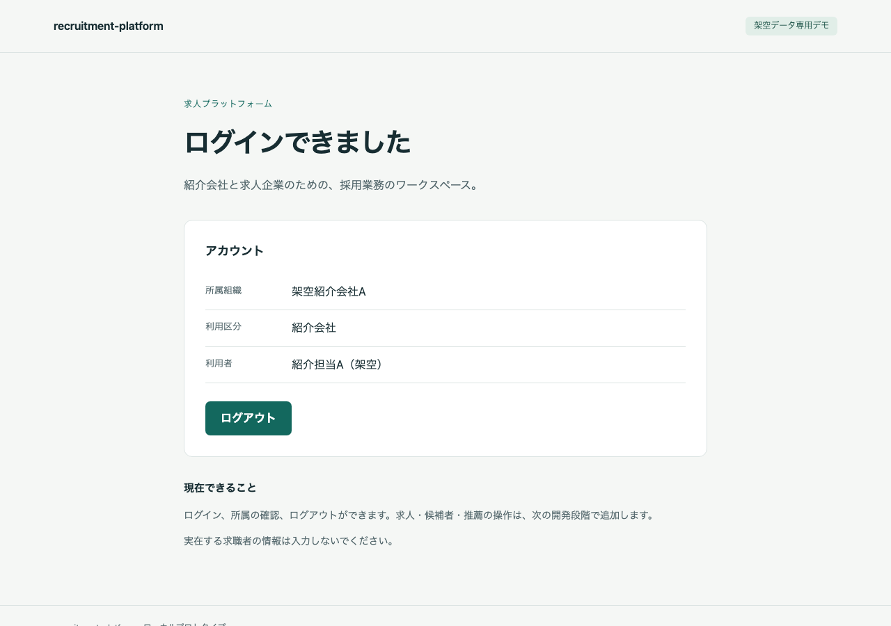
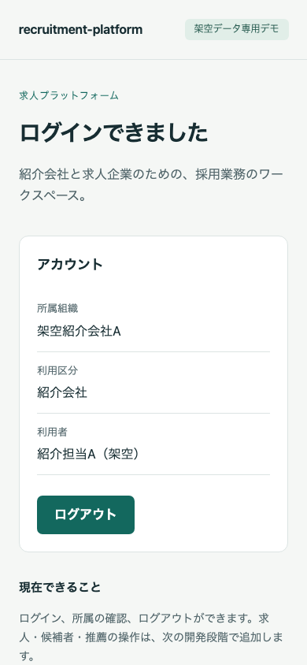

# M1 認証基盤の実装結果

2026-10-15。M0の[両環境での方式確認](2026-10-15-m0-completion.md)を受け、承認されたM1まで実装した。**M1のローカル認証基盤は起動・操作確認済み。M2には進んでいない。**

> その後のM1不足修正と再実行可能なブラウザE2Eは[追補記録](2026-10-15-m1-e2e-report.md)を参照。この文書は初回実装の時点記録。

## 実装した内容

- Docker Composeの7サービス：入口、Next.js Web、Rust/Axum/SQLx API、アプリPostgreSQL、Keycloak、Keycloak用PostgreSQL、内部PDF service。
- OIDC Authorization Code + PKCE S256。標準openidconnectライブラリで署名・issuer・audience・期限・nonceを検証。RS256に限定し、redirectは固定。HTTP clientのredirect追従を停止し、5秒timeoutを設定。
- 5分有効の認証試行をDBへ保存。state hashと短期cookieのbinding hashが一致した行だけを単回消費。PKCE verifierはAES-256-GCMで暗号化し、state/cookieをAADへ含める。
- 256bitの不透明sessionを発行し、DBはSHA-256 hashのみ保存。有効期限8時間、HttpOnly/SameSite=Lax/host限定cookie。HTTPはloopback開発のみ。OIDC tokenをブラウザやDBに保存しない。
- 1ユーザー1組織。信頼したrealm初期設定の(issuer,subject)だけで4利用者と4組織を対応付け、所属・OIDC identity・組織kindをDB triggerで不変にした。メールによる所属決定や自動登録は行わない。
- /meは毎回DBでuser/組織の有効性を照合。logoutはOriginとsession由来HMAC CSRFを検証し、DB session失効とcookie解除を行う。
- migration・認証・業務runtimeのDBロールを分離。APIは認証用non-owner/NOSUPERUSER/NOBYPASSRLSロールだけを使用する。初期化はchecksum/transaction/advisory lockで管理し、架空fixtureは再実行で既存行を初期化し直さない。
- ローカル秘密値を生成するsetup、起動/migrate/status/stopコマンド、最小のログイン・所属表示・ログアウト画面、Apache-2.0 LICENSEと主要依存一覧。

PDF serviceはM1ではhealth endpointのみ。レジュメ検査と請求PDF生成の製品HTTP APIはM3/M5で実装する。業務表のRLS・求人/候補者/推薦・ファイル処理も未実装。

## 実行環境と確認

macOS 27.0.1 / Apple Silicon、専用Colima profile（4 CPU/8GiB、Linux arm64）を新規作成した。既存defaultとM0 profileは起動・変更していない。DB/PDF/Web/APIはホストへ公開せず、入口3000とIdP18080だけを127.0.0.1へ公開。7サービスすべてhealthyを確認した。

[証拠JSON](2026-10-15-m1-evidence.json)に実version、image ID、公開port、実行設定、個別結果とsource hashを保存した。

| 確認 | 結果 |
| --- | --- |
| Rust型検査・Linux/arm64 release build | 成功 |
| Next.js production build・TypeScript検査 | 成功 |
| 7サービスの新規起動 | 全healthy、Keycloakも別PostgreSQLへ永続化 |
| 4アカウントのログイン→固定所属表示→logout | 成功。同じbrowser contextでもA/B/X/Yを交代可能 |
| 未登録・無効user・無効組織 | callback 403、session未発行 |
| 既存sessionのuser/組織無効化 | 次の/meを401 |
| nonce不一致・期限切れattempt・cookie binding欠落・state不正・callback再利用 | 400、認証しない |
| session期限切れ・logout後 | /meを401 |
| CSRF欠落・Origin不正 | logoutを403、正常CSRF/Originでのみ失効 |
| API再起動 | DB sessionで認証状態を維持 |
| DBロール/不変所属 | 認証roleに管理/BYPASS/所有権なし、所属UPDATEをDBで拒否 |
| migration/fixture再実行 | checksum維持、既存4組織/4所属userを保持 |
| 画面identity/非空/overlay/console | 正しいtitleと内容、framework例外なし。意図した401/403だけを除外してconsoleに異常なし |
| 操作と表示 | 実login/logout、Tab/Enterでログイン開始、1280×900/390×844のPNG目視、横overflowなし |

Browser pluginは利用可能な一覧にないため、既存Playwright 1.62.1を利用した。UI操作の経路は「入口→Keycloakログイン→所属表示→ログアウト→ログイン入口」。画面はPNGで確認した。チェック数だけを品質の証明とは扱わない。

有効期限の確認ではDB内の期限を過去へ変更して拒否を確認した。8時間/5分の実経過待ちとは区別する。署名/issuer/audience等の改変入力のM0確認を、Rust製品実装での全異常系試験へ読み替えない。製品のLinux/amd64 CI・全ブラウザ・読み上げ・画面拡大・実運用は未確認。

## 既知事項と停止範囲

- [依存一覧](../../THIRD_PARTY.md)のとおり、npm auditは0件、cargo auditはrsa 0.9.10のRUSTSEC-2023-0071を1件検出。ignoreしていない。現APIは公開鍵検証のみでRSA秘密鍵処理を持たないため、ローカルM1確認の阻害要因とは判定しなかった。秘密鍵処理の追加と配布前には再評価する。OS/image全体の監査はM6/M7に残る。
- HTTP loopback専用の設定をコードで制限している。HTTPSの本番配置・外部公開の準備完了ではない。
- IdPのSSO sessionはアプリlogoutで終了しない。再ログインではprompt=loginを使い、必要時はKeycloak標準の別利用者入力へ戻る操作を行う。
- 期限切れsessionの定期整理、拒否時の詳細な専用UI、業務監査と全RLS、回帰/E2E CIは後続段階。業務データを物理削除するAPIはない。

M1完了で作業を停止する。ローカル7サービスは操作確認用に起動したままとし、停止はREADMEのstop手順で行える。秘密値、browser cookie、OIDC code/token、私有ログはGitへ含めない。入口はqueryを含み得る標準error logを保存せず、method/status/gateway IDだけの運用logでHTTP失敗も記録する。認証の詳細拒否はAPIのcode/request IDで記録する。

## 残工数

既存WBSから完了段階M0/M1を除いた、**M2〜M7は64〜112時間の計画幅**。

| 残段階 | 時間仮説 |
| --- | ---: |
| M2 求人・候補者 | 12〜20時間 |
| M3 PDF受付・検査・復旧・配信 | 12〜20時間 |
| M4 推薦・選考・RLS/競合/監査 | 16〜28時間 |
| M5 通知モック・固定1ページ請求PDF | 4〜8時間 |
| M6 結合/E2E/CI・配布物確認 | 14〜24時間 |
| M7 文書・配布・第三者再現 | 6〜12時間 |

今回の経過時間や自動検証の速度から、人の実装工数や削減率を逆算していない。全体80〜140時間は当初の仮積算として残し、64〜112時間を追加予算の承認や完成保証とは扱わない。現時点で範囲を追加したり、この幅を増減する根拠は得ていない。

## 画面

デスクトップ・ログイン後。

390px幅・ログイン後。

