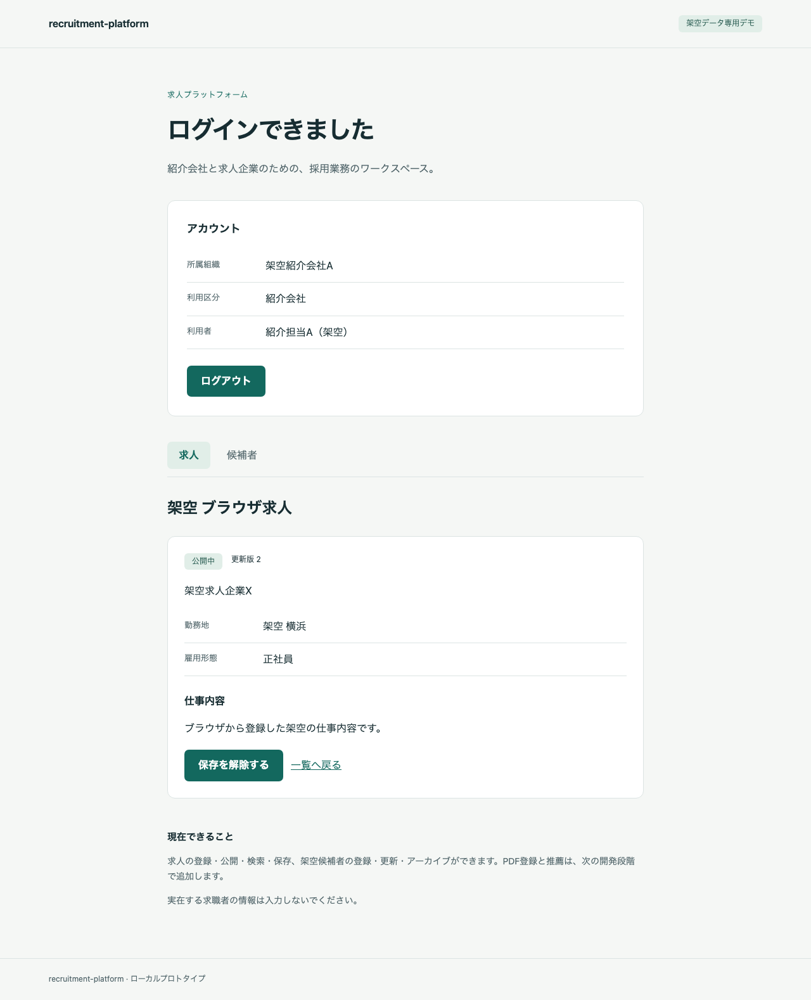
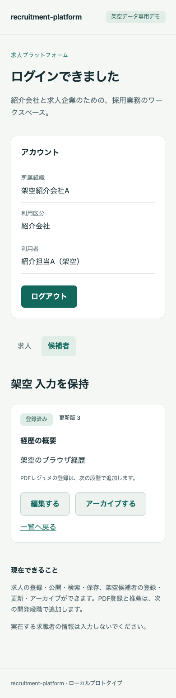

# M2 求人・候補者機能と組織分離

2026-10-15。**M2は合意した範囲で実装・検証を完了した。**実装/E2Eの対象commitは `7ffda477e37513beaf9bfa9ad82d6dc266d96eda`。M3のPDF登録・検査・配信には進まない。

## 実装した内容

- 求人企業の自社求人一覧・下書き作成・編集・公開・募集終了。紹介会社は公開求人だけを検索/閲覧でき、勤務地・雇用形態・保存で絞り込める。
- 紹介会社ごとの求人保存。募集終了後は一覧/詳細から非表示になり、保存の解除は可能。
- 自社の架空候補者の登録・一覧・検索・更新・不可逆のアーカイブ。企業は候補者原本へアクセスできない。作成時は架空データ確認が必須。
- `app_auth` と業務用 `app_runtime` の接続poolを分離。業務表はENABLE/FORCE RLS、要求ごとにtransaction内でuser/orgを設定し、文脈なしでは拒否。認証ロールに業務表権限を与えない。
- 作成/状態変更/アーカイブのIdempotency-Key、canonical JSON hash、24時間の結果参照、version競合、求人UUIDによる共通advisory lock、3秒のlock待ち上限、監査の同時commit。
- 検索のパラメータ化とLIKEエスケープ、安定cursor、未知の入力項目の拒否、JSON 64KiB制限。API/DBの文字数上限を合わせた。
- 空状態、拒否、通信エラー、重複操作中の無効化、409での入力保持と明示的な読込み、ログイン確認失敗時の入力保持/書込み拒否。他タブlogoutでは入力も破棄し、個人情報をbrowser storageへ保存しない。

既存migrationは変更せず `0002_jobs_candidates.sql` を追加した。fixtureは架空求人8件・候補者6名を追加し、再実行で既存行を上書きしない。通常デモの既存DBにも適用し、7サービスhealthy、`http://localhost:3000/ready` の200を確認した。nginxのJSON上限はreloadで反映済み。

APIは `services/api/src/business.rs`、画面は `apps/web/app/business.tsx`。候補者詳細のdocumentsはM2では空配列で、PDFの登録・閲覧APIは未実装。M2で確定した検索/アーカイブ/cursor/lockの契約は[API設計](../design/05-api.md)に追記した。

## 検証結果

arm64ローカルは全30件成功、skip/retryなし。実装commitと37ファイルのhash一致、実行中のソース不変、clean tree、秘密値ログ検査、終了時stopを確認した。[ローカル証拠](2026-10-15-m2-local.json)。runnerの経過時間は173.684秒（build/up/E2E/stopを含む）。

Linux/amd64の[CI実行](https://github.com/mt4110/recruitment-platform/actions/runs/38686590817)も全30件成功した。[CI証拠](2026-10-15-m2-amd64.json)を回収し、両環境の37ファイルのhash一致・clean checkout・実行中のソース不変を照合した。CI jobは7分13秒。以下の経過時間は実行待ちであり、人の開発工数ではない。

| 環境 | 全30件 | ソース一致/実行中不変 | ログ検査/stop | runner経過時間 |
| --- | --- | --- | --- | ---: |
| Docker 29.5.2 / aarch64 | 成功 | 確認 | 確認 | 173.684秒 |
| Docker 28.0.4 / x86_64 | 成功 | 確認 | 確認 | 406.134秒 |

30件は、認証20件とM2の10件を含むPlaywright suite。M2にはブラウザ実操作・実HTTP API・通常DBロールの直接確認を含め、30件すべてが画面操作だけの試験とは扱わない。正常なOIDCは実Keycloakで、応答喪失だけをPlaywright routeで制御する。

| M2の確認 | 結果 |
| --- | --- |
| runtimeのRLS、文脈なし/transaction終了後の拒否、書込み/列権限、auth/runtime分離 | 両環境で成功 |
| BからAの候補者、YからXの求人、企業から候補者原本の拒否 | 両環境で成功 |
| 未認証、CSRF/Origin、UUID/列挙/文字数/未知の列/架空確認/不正JSON/容量 | 両環境で成功 |
| 求人の作成・編集・公開・終了、検索/保存、cursorの重複なしと条件変更の拒否 | 両環境で成功 |
| 候補者の作成・更新・アーカイブ、完了キーの再実行で重複しない | 両環境で成功 |
| 同時更新のversion競合、job lock待ち上限503と未変更 | 両環境で成功 |
| 実画面の一巡、他組織の詳細拒否、409の入力保持、応答喪失後の同キー再送、期限切れ時の入力保持 | 両環境で成功 |

初回の失敗を成功扱いにはしていない。求人一覧追加で組織名selectorが複数一致したためアカウント欄へ限定し、Next.js route announcerとアプリ通知もscopeを分けた。不正JSONはPlaywrightの自動JSON文字列化を避けBufferで送る。所有者検査triggerがRLSのWITH CHECKより先に23514で拒否することを確認し、列権限42501/行不可視の確認と区別した。transaction終了後の試験は、SET LOCAL ROLEが管理者へ戻るテスト接続を修正し、同じapp_runtimeのまま文脈だけが消えて0件になることを確認した。初回/修正中のrunは非公開の`.local`へ保持し、再実行の成功記録を正本にする。

Rust `cargo check --locked` と `cargo clippy -- -D warnings`、Next.js production buildとTypeScript型検査は成功。npm auditはWeb/E2Eとも0件。RustSecは既知の `RUSTSEC-2023-0071`（rsa 0.9.10）1件で、ignoreせず記録する。新しい依存は追加していない。使用経路と監査範囲は[THIRD_PARTY](../../THIRD_PARTY.md)を参照。

## 画面QA

対象フローは「企業の求人登録→公開→紹介会社の検索/保存→募集終了で閲覧不可」と「紹介会社の架空候補者登録→編集/競合→アーカイブ→他社の詳細拒否」。Browser plugin not availableのためリポジトリのPlaywright/Chromiumを使った。1280×900と390×844、専用port 3001/18082、別DB/IdP/browser contextで通常デモと分離する。

| 確認 | 結果 |
| --- | --- |
| ページidentity（URL/title） | 両環境で成功 |
| 意味のある表示・空白画面なし | 両環境で成功 |
| framework overlayなし | 両環境で成功 |
| 予期しないconsole/runtime errorなし | 両環境で成功 |
| 架空情報だけの画面証拠・目視 | 両環境で成功 |
| 実操作と次の状態、狭い画面の横溢れなし、キーボード操作 | 両環境で成功 |

秘密値・URLを伏せた結果JSONと許可したPNGだけを共有する。生成秘密値とtoken形式を7サービスのログで走査し、テスト専用サービスを終了時にstopする。trace/動画/storageState/通信dump/失敗時の自動画面保存はしない。既存/テスト用container・volume・設定は削除していない。ログ走査は未知の漏えいを包括的に否定するものではない。

主要コマンドは `cargo check --locked --manifest-path services/api/Cargo.toml`、`cargo clippy --locked --manifest-path services/api/Cargo.toml -- -D warnings`、`npm run build --prefix apps/web`、`npm run typecheck --prefix apps/web`、`python3 scripts/e2e.py`。再実行手順は[E2E README](../../e2e/README.md)。Browserプラグインの導入は、今後アプリ内で画面を確認したい場合の選択肢。

## 残工数と停止範囲

求人・保存・候補者のUI/API、組織分離、入力/競合/再試行の制御と再実行可能なE2EはM2として完了。最終記録の変更対象は文書・証拠JSON・画面だけで、検証済み実装/E2Eのソースは変更しない。M3には進まず、ここで停止する。

| 残る段階 | 既存WBSの計画幅 |
| --- | ---: |
| M3 PDF登録・検査・復旧・配信 | 12〜20時間 |
| M4 推薦・選考・snapshot・共有失効 | 16〜28時間 |
| M5 通知モック・固定1ページ請求PDF | 4〜8時間 |
| M6 業務全体の回帰・E2E/CI・配布確認 | 14〜24時間 |
| M7 起動/操作文書・配布・第三者再現 | 6〜12時間 |
| 合計 | **52〜92時間** |

既存の80〜140時間計画から、残るM3〜M7を単純合算した幅。実績からの再見積もりや追加予算承認ではない。M2で前倒しした基盤・E2Eは後続で再利用し、M6との二重計上を避ける。人の開発時間は未計測で、runner/CIの経過時間を工数へ換算しない。全ブラウザ/読み上げ、実在個人情報、本番HTTPS、OS/image全体の監査、商用運用適合性は未検証。M3以降の受入条件を完了扱いにしない。

## 画面

求人詳細と組織内の保存（arm64、1280px）。

候補者更新後の詳細（arm64、390px）。日本語の表示、ボタン配置、横溢れなしを目視した。amd64 CIの同じ2画面も回収して目視し、文字の欠けや重なりは見つからなかった。画素の完全一致や実測の操作完了率は受入条件にしていない。

