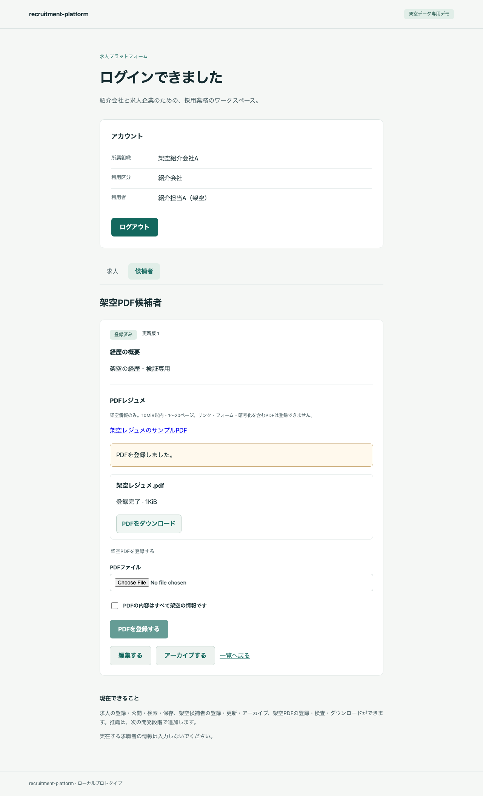
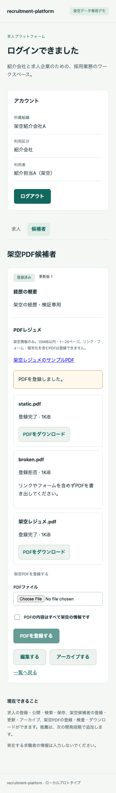
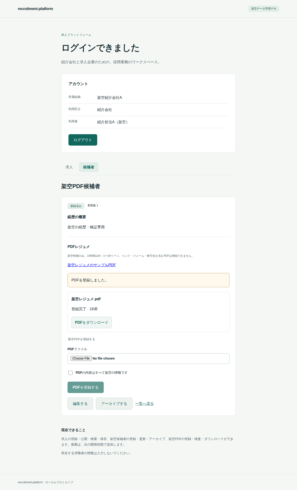
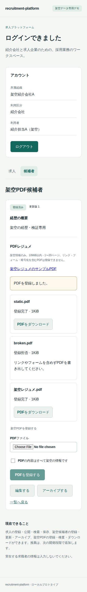

# M3 PDF登録・検査・復旧の完了記録

2026-10-15。架空データ専用、M4には進まない。

## 実装した内容

候補者へのmultipart PDF登録、static-resume-v1の隔離検査、状態/拒否理由/再試行の画面、認可付き原本downloadを追加した。実装commitは`4e96d846fd74f38d34fd403d876b7a7043016716`。新規migration `0003_documents.sql`を追加し、既存migration/資格情報/データを保持する。

- 最大10MiB・1〜20ページの静的PDF。タグ付きPDFの構造属性を文脈と型で検査し、JavaScript/リンク注釈/フォーム/添付/暗号化/構文警告・破損/構造上限超過を拒否する。サンプルPDFは実在情報を含まない。
- 認証/CSRF/所有確認と架空確認の後、30秒上限で管理stagingへstreamし、実bytesのSHA-256を算出。元表示名・candidate ID等とともに冪等hashへ含める。
- 文書ID/元の冪等記録を永続予約してcommitし、外部検査をDB transactionの外で行う。60秒leaseのCAS再取得で同じIDを復旧し、旧leaseの確定を拒否する。
- 検査合格のpolicy/hashを保存し、fsync済みstagingを同一volumeの確定先へcreate-onlyのhard linkで配置。既存先はsize/hashを照合し、上書きしない。candidate→documentのlock順でready/拒否と監査を確定する。
- ready文書はDB triggerと更新権限で不変。取得前にsize/hashを照合し、企業/他社/文脈なしの通常DBロールを拒否する。保存keyはJSON/ログへ出さない。
- PDF serviceは共有鍵付き内部API、外向き通信なし、非root/read-only/capabilityなし、DB認証情報/保管volumeなし。子processに秘密環境を渡さず、メモリ256MiB・CPU5秒・wall5秒、検査同時1件。service全体384MiB、APIのupload/retry同時2件。
- 2秒間隔のpending確認、期限切れ時の元登録者のretry、拒否理由、同キー再送、ダウンロード、架空確認、狭い画面の操作を追加。ログアウト/認証失効時に機密状態を破棄し、browser storageへ保存しない。

API/保管契約は[API設計](../design/05-api.md)、検査・復旧の順序は[安全性設計](../design/06-security.md)、依存と既知指摘は[THIRD_PARTY](../../THIRD_PARTY.md)。M4の推薦・snapshot・企業共有APIとM5の請求PDFは未実装。

## 検証結果

arm64ローカルとLinux/amd64の[CI実行](https://github.com/mt4110/recruitment-platform/actions/runs/38698614972)で各39件が成功、skip/retryなし。[ローカル証拠](2026-10-15-m3-local.json)・[amd64証拠](2026-10-15-m3-amd64.json)に結果と隔離確認を保存した。両環境の50ファイルのsource hashが実装commitと一致し、clean checkout・実行中のソース不変・7サービスの秘密値ログ検査・終了時stopを確認した。

| 環境 | 全39件 | source一致/実行中不変 | 隔離/ログ検査/stop | runner経過時間 |
| --- | --- | --- | --- | ---: |
| Docker 29.5.2 / aarch64 | 成功 | 確認 | 確認 | 227.278秒 |
| Docker 28.0.4 / x86_64 | 成功 | 確認 | 確認 | 460.953秒 |

CI jobは8分7秒。runner時間はbuild/up/test/stopを含み、人の開発工数ではない。pikepdf 10.17.0 / libqpdf 12.4.2を両環境で照合した。実際の検査workerの/procから256MiB/CPU5秒の設定と秘密環境の除外を確認し、serviceのcapabilityなし・Seccomp・非root/read-only・volume/DB認証情報なし・外向き通信拒否・共有鍵必須・同時検査1件を実行確認した。資源制限の値の確認と、全種類の資源枯渇を誘発する試験は区別する。

39件はM1の20件・M2の10件・M3の9件で、ブラウザ実操作のほか、実HTTP API、通常DBロール、専用テスト環境の障害制御を含む。すべてを画面操作だけの試験とは扱わない。PDFのpolicy検証は20 fixtureで、正常/タグ付き/ちょうど10MiB/ちょうど20ページを許可し、残りの禁止/破損/暗号化/21ページ等を拒否。10MiB超はtransportで413とする。

専用環境内でPDF serviceのpause/unpause、API restart/SIGKILL、lease期限/token制御を実行した。実経過60秒待ちの代わりに対象テスト行だけを期限切れにする。検査前の停止とAPI再起動後の同ID復旧、検査済み確定ファイルからの完了、欠落/不一致の停止、旧leaseの拒否、アーカイブ前後の登録/再送契約を確認する。検査後配置済みの状態は、テスト専用DBの検査markerとcreate-only linkで再現したfixtureを使い、実際のSIGKILLは検査前に行った。全機械命令位置でのcrashやホスト電源断を網羅した試験ではない。

Rust clippy（-D warnings）、Next.js production build、TypeScript、Python/JS構文確認を実施した。RustSecは既知のRUSTSEC-2023-0071が1件、追加したPython4パッケージのOSV照合は0件。OS/imageとwheel同梱native library全体の監査は後続。

初回の統合試験では、tmpfs上のfixtureをcompose cpで取り出せなかったため、exec経由の制限付きarchiveへ変更した。ヘッダーの二重付与をgatewayで正規化し、Composeテストhelperのcwdを固定した。強制停止後はAPI起動と/ready待ちを分けた。修正中のrunとテストデータは私有の.localに保持し、最後の確定ソースの結果を正本とする。

## 画面QA

フローは「候補者詳細→PDF選択と架空確認→登録完了→download→拒否PDFの理由→期限切れpendingの再試行」。Browser plugin not availableのため既存Playwright/Chromiumを使用した。専用port3001/18082、1280×900と390×844で検証し、通常デモからDB/IdP/browser contextを分離した。

| 確認 | arm64 / amd64 |
| --- | --- |
| URL/title・意味のある非空表示 | 成功 |
| framework overlayなし | 確認 |
| 予期しないconsole/runtime errorなし | 確認 |
| 登録→download→拒否理由→retryの操作 | 成功 |
| キーボード・狭い画面の横溢れなし | 確認 |
| 架空情報だけの画面・日本語/配置の目視 | 確認 |

両環境のdesktop/mobile PNGを回収し、日本語の欠け・重なり・主操作のはみ出しは見つからなかった。フォントの差があり、画素の完全一致は保証しない。trace/動画/storageState/通信dump/失敗時の自動画面保存はしない。ログ検査は未知の漏えいの包括的な否定ではない。

主要コマンドは`cargo clippy --locked --manifest-path services/api/Cargo.toml -- -D warnings`、`npm run build --prefix apps/web`、`npm run typecheck --prefix apps/web`、`python3 scripts/e2e.py`。[E2E手順](../../e2e/README.md)から再実行できる。通常デモの7サービスhealthyと/ready=200、API/Web/PDF serviceのimage IDが検証済みarm64 imageと一致することも確認した。

## 制約・残工数・停止範囲

M3の実装・E2E・Linux/amd64 CI・証拠照合を完了した。この最終記録で変更するのはREADME/進捗文書/証拠JSON/PNGだけで、検証済み実装ソースは変更しない。M4には進まず、ここで停止する。

| 残る段階 | 既存WBSの計画幅 |
| --- | ---: |
| M4 推薦・選考・snapshot・共有失効 | 16〜28時間 |
| M5 通知モック・固定1ページ請求PDF | 4〜8時間 |
| M6 業務全体の回帰・E2E/CI・配布確認 | 14〜24時間 |
| M7 起動/操作文書・配布・第三者再現 | 6〜12時間 |
| 合計 | **40〜72時間** |

M3の当初計画は12〜20時間。上の残工数は既存WBSの単純合算で、実績による再見積もりや追加予算の承認ではない。人の開発工数は未計測で、runner/CI待ち時間を人の工数へ換算しない。前倒しした回帰基盤をM6で二重計上しない。

一時/拒否/重複stagingとmanifestを保持し、自動GC/削除を実行しないため容量は増加する。管理用の整理はDB参照・lease・受信中の状態を確認する別作業。PDF policyは受付範囲を限定するもので未知の悪性PDFを包括的に検出する保証ではない。全ブラウザ/読み上げ、本番HTTPS、実在個人情報、商用運用適合性、負荷・ホスト電源断は未検証。

## 画面

arm64の登録完了画面（1280px）。

arm64の拒否理由・復旧後の一覧（390px）。

amd64の同じ操作画面も目視した。

