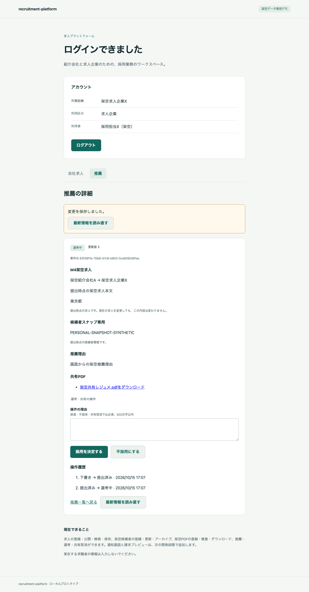
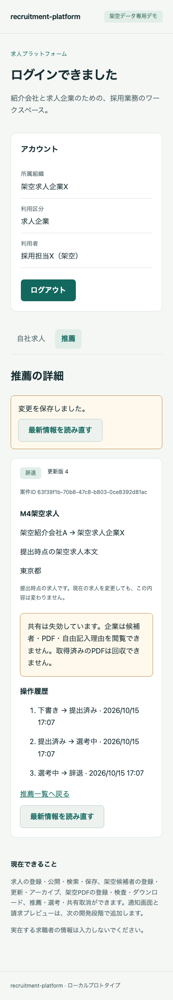
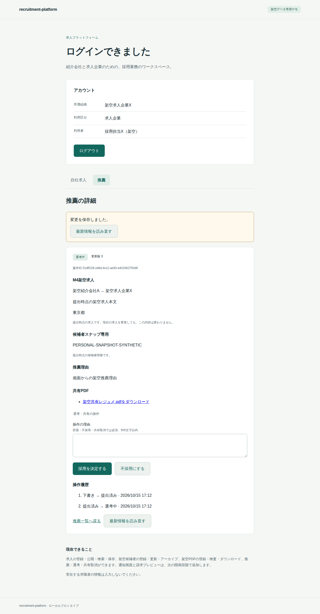
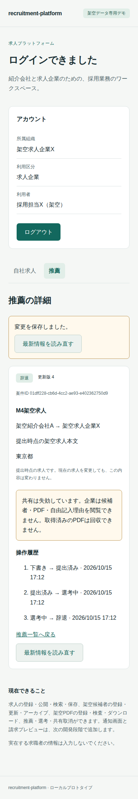

# M4 推薦・選考・共有失効の完了記録

2026-10-15。架空データ専用のM4。M5には進まない。実装commitは`d2a7e45596d4b17ea37d32b161f3a9e5ed8115c3`。

## 実装した内容

推薦の下書き・理由更新・提出、企業の選考開始/不採用/採用決定、紹介会社の辞退・共有取消をUI/APIへ追加した。所属・候補者・求人の参照は不変とし、1ユーザー1組織を継続する。

- 提出時に候補者・求人のversion、非アーカイブ、求人公開中、架空/共有操作の確認、同候補者のready PDFを検査。候補者本文、求人内容/組織名、選択PDFの不変参照を一度だけ保存する。
- 求人の編集/募集終了と同じjob advisory lockを使い、job→candidate→applicationの順に直列化する。選考/辞退/撤回はapplication行だけをロックする。
- APIの通常runtimeとENABLE/FORCE RLSで、agencyの自社所有とemployerのE_SHAREDを判定する。企業の共有ファイル取得はapplication_documentsから保存済み参照を読み、documents原本へJOINしない。size/hash検査とno-store/attachmentを継続する。
- 共有失効後も企業に案件/求人metadata・状態/時刻の履歴を返し、candidate_id/候補者snapshot/推薦理由/文書一覧/placementと、履歴の自由記入理由を省く。候補者・共有ファイルの行もRLSで拒否する。
- 新規推薦・提出・選考・辞退/撤回のJSON POSTは、scope付きUUID keyとcanonical hashで冪等化する。現在の読取り認可で同resourceの現在DTOを返し、共有失効後の企業への再送にも旧本文を再生しない。別keyの二重進行は部分一意制約で拒否する。
- version競合、状態表外の操作を拒否。採用はplacementを一度作り、採用後の共有撤回でも維持する。既に撤回済みの新key要求はversion確認後no-opで、event/通知/監査を増やさない。
- 業務、event、相手組織宛ての未送信通知、監査、冪等記録を同じtransactionでcommitする。eventにはapplication_versionを保存し、同じ版の二重作成をDB制約で拒否する。失敗は全体をrollbackする。
- 下書きの共有内容プレビュー、PDF選択、架空/共有操作確認、状態別操作、履歴と失効表示を追加した。一覧/詳細は2秒・focus/再表示で再取得し、失効後の企業画面から候補者名/本文/PDFを除く。409では入力を上書きせず、認証失効では未保存の推薦理由だけを無効な欄で保持する。

API/DTO/再送契約は[API設計](../design/05-api.md)、RLS/制約/lockは[DB設計](../design/04-data-model.md)、共有経路は[安全性設計](../design/06-security.md)。通知の保存はM4の原子性に必要な範囲だけで、通知API/画面・請求PDFはM5に残す。

## migration・依存

適用済み0001〜0003を変更せず、0004_applications.sqlと0005_snapshot_validation.sqlを追加した。0004には6表とRLS/列権限/trigger、文書の所有者付き参照keyを追加する。SQL CHECKではNULLが条件を通る可能性があるため、0005で提出時の求人版とready PDFの検査policyを明示的に非NULLにする。正常な既存データを保持し、削除/reset/履歴改変を行わない。

既存SQLxのjson featureを有効化した。Cargo.lockのpackage/version変更と新しい製品依存の追加はない。RustSecは既知のRUSTSEC-2023-0071が1件。使用経路と未監査範囲は[THIRD_PARTY](../../THIRD_PARTY.md)。

## 検証結果

arm64ローカルとLinux/amd64の[CI実行](https://github.com/mt4110/recruitment-platform/actions/runs/38703009219)で各50件成功、skip/retryなし。[ローカル証拠](2026-10-15-m4-local.json)・[amd64証拠](2026-10-15-m4-amd64.json)を保存した。両環境の56ファイルのsource hashが実装commitと一致し、clean checkout・実行中のソース不変・7サービスの秘密値ログ検査・終了時stopを確認した。test_selection=fullで部分実行ではない。

| 環境 | 全50件 | source一致/不変 | ログ検査/stop | runner経過時間 |
| --- | --- | --- | --- | ---: |
| Docker 29.5.2 / aarch64 | 成功 | 確認 | 確認 | 259.986秒 |
| Docker 28.0.4 / x86_64 | 成功 | 確認 | 確認 | 490.962秒 |

CI jobは8分39秒。runner時間はbuild/up/test/stopを含み、人の工数とは区別する。M3のPDF隔離確認も両環境で再成功した。Rust clippy（-D warnings）、Next.js production build、TypeScript型検査、E2EのJS構文確認も成功した。

50件はM1の20件、M2の10件、M3の9件、M4の11件。画面操作、実HTTP API、通常DBロールのSQL、専用環境の競合制御を含み、すべてを画面操作だけの試験とは扱わない。

| M4の確認 | 結果 |
| --- | --- |
| 下書きは企業から404、提出後だけ選択PDFを共有、非選択PDF・原本の拒否 | 両環境で確認 |
| 候補者/求人編集・募集終了後も提出時snapshotは不変 | 両環境で確認 |
| B/Yの直接ID・一覧・PDFを拒否、contextなし/次transactionもRLS拒否 | 両環境で確認 |
| snapshot/参照の更新権限なし、提出後の本文不変、ready検査markerの非NULL | 両環境で確認 |
| consent/架空確認/文書ID/版/列/CSRF/Origin不正と失敗後の全体rollback | 両環境で確認 |
| 同key同時提出、完了選考の共有失効後の再送、異payload409、撤回no-op | 両環境で確認 |
| submitted/screening/rejected/hiredの共有、withdrawn/撤回後の失効 | 両環境で確認 |
| 状態表外の操作拒否、採用記録一度のみ・撤回後維持、再推薦の制約 | 両環境で確認 |
| 同versionの選考と撤回の競合、求人終了が先の場合のJOB_NOT_OPEN | 両環境で確認 |
| 一覧のfilter/cursorと失効後の候補者名の除外 | 両環境で確認 |
| 画面の提出→選考→共有取消、直接PDF拒否、応答喪失再送・409/期限切れの入力保持 | 両環境で確認 |

正常系は実Keycloak/アプリDB/APIを使う。応答喪失だけPlaywright routeで応答を落とし、求人終了の競合はテスト専用DBで同じjob lockを保持して順序を制御した。M3の障害制御も全件suite内で再実行する。テストデータ・container・volume・設定と過去runは保持し、最後にそのrunのサービスだけstopする。

開発中のM4部分実行はrun.jsonのtest_selectionで区別した。最初の画面テストは選択肢の文字列を含むコントロール名を特定できず、候補者/推薦理由の明示的な名前を付けた。失効時に保持する欄にも同じ名前を付け、応答喪失・409・期限切れを再確認した。部分実行や修正中のrunを最終の全件成功として扱わない。

## 画面QA

フローは「求人→候補者と推薦理由の下書き→共有内容/選択PDF/確認→提出→企業の選考開始→紹介会社の共有取消→企業の本文/PDF消失とmetadata表示」。Browser plugin not availableのため、既存Playwright/Chromiumを使った。専用port3001/18082、別DB/IdP/browser context、1280×900と390×844で確認する。

| 確認 | arm64 / amd64 |
| --- | --- |
| URL/title・意味のある非空表示 | 成功 |
| framework overlayなし | 確認 |
| 予期しないconsole/runtime errorなし | 確認 |
| 下書き→提出→選考→撤回・PDF拒否の実操作 | 成功 |
| キーボード・390pxで横溢れなし | 確認 |
| 架空情報だけの画面・日本語/配置の目視 | 確認 |

両環境のdesktop/mobile PNGを回収して目視し、日本語の欠け・重なり・主操作のはみ出しは見つからなかった。フォントの違いがあり画素の完全一致は保証しない。trace/動画/storageState/通信dump/失敗時の自動画面保存はしない。ログ検査は未知の漏えいの包括的な否定ではない。

通常デモは既存データを保持して0004/0005を適用し、7サービスhealthyと/ready=200、API/Web/PDF serviceのimage IDが検証済みarm64 imageと一致することを確認した。

主要コマンドは`cargo clippy --locked --manifest-path services/api/Cargo.toml -- -D warnings`、`npm run build --prefix apps/web`、`npm run typecheck --prefix apps/web`、`python3 scripts/e2e.py`。[E2E手順](../../e2e/README.md)から再実行できる。

## 完了・残工数・停止範囲

M4の実装・E2E・Linux/amd64 CI・ソース/証拠照合を完了した。この最終記録ではREADME/進捗文書/証拠JSON/PNGだけを追加し、検証済みコードを変更しない。M5には進まず、ここで停止する。

| 残る段階 | 既存WBSの計画幅 |
| --- | ---: |
| M5 通知モックの画面/API・固定1ページ請求PDF | 4〜8時間 |
| M6 業務全体の回帰・E2E/CI・配布確認 | 14〜24時間 |
| M7 起動/操作文書・配布・第三者再現 | 6〜12時間 |
| 合計 | **24〜44時間** |

M4の当初計画は16〜28時間。残工数は既存WBSの単純合算で、実績による再見積もりや予算の追加承認ではない。人の開発時間は未計測で、runner/CIの経過時間を人の工数へ換算しない。前倒しした回帰基盤をM6と二重計上しない。

失効commit後に始まる取得は拒否するが、既に許可したstream/取得済みPDF・本文は回収できない。browser storageへ機密状態を保存しない。M3のstaging/拒否ファイルの自動GCはなく、容量は増加する。全ブラウザ/読み上げ、本番HTTPS、実在個人情報、OS/image全体の監査、負荷・商用運用適合性は未検証。

## 画面

企業の選考中画面（arm64、1280px）。提出時点の求人・候補者・共有PDFを表示する。

共有失効後の企業画面（arm64、390px）。候補者本文・PDF・自由記入理由を除き、案件/求人/状態履歴を残す。

Linux/amd64の同じ操作画面。

