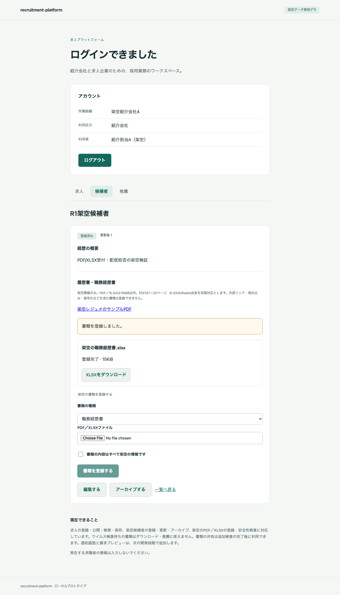
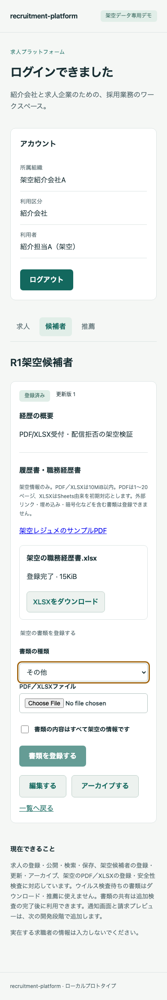

# R2 実AV・定義更新・既存書類の再検査

2026-10-16。対象はR2。R3・M5には進まない。実装commitは `60f757cd4982c982214ce781d6ec059659812fc0`。arm64 / Linux/amd64の最終確認を完了。R2で停止し、R3へは進まない。

## 実装

- 実ClamAV 1.5.4のUnix INSTREAMへ、認証付きHTTPでbytesだけを渡す。APIはhash/nonce/engine/世代/DB版・hashを照合し、AV→形式検査の順で処理する。合格記録の保存直前にもロード中の世代と鮮度を再照合する。
- FreshClamは起動時と6時間ごとに正常確認する。署名検証・非後退を確認後、不変directoryをpublishする。同世代の更新なし確認と新世代のロードを区別する。失敗・24時間超・hash/版/世代の不一致では新しいcleanを作らない。
- scanは外向き通信のない専用network、定義volumeはRO。updaterは専用の外向きnetworkと定義volumeだけを持ち、DBや原本に接続するnetwork/認証情報/volumeを持たない。9サービス。非root/RO root/cap drop/pids上限。scan 2GiB、updater 4GiB、各1CPU。
- scan同時1、HTTP handler上限4、INSTREAM 10MiB、展開64MiB/16MiB/深さ8/1,000ファイル、engine・socket 20秒。異常時はworkerを停止し、再ロード後に再開する。検出文字列・書類bytes・共有鍵をログへ出さない。
- 新規uploadは両検査合格で201/ready、明示retryは200。技術障害は503でpendingを維持し、元operationのleaseを解放する。検出/確定した上限超過は422/rejected。blockedはcleanより優先する。
- `0007_document_av.sql`は追記migration。checksのINSERTは同一agency・元登録者・同一hashに限定し、UPDATE/DELETEを許可しない。再検査はdocument単位のjob・元操作key・120秒lease/CAS。旧ready/policy/bytes/提出snapshotを変えず、成功・blockedを別表へ記録する。旧原本/共有は未合格の間404、合格後は既存認可内で取得できる。
- user 10件/分・org 30件/分、org 512MiB/global 1GiBをDBの短いadvisory lockで予約する。upload前に上限予約し、受信済み容量へ精算する。失敗・中断でサイズが不明なら予約を残し、既存ファイルは削除しない。冪等replayで残る受信bytesも計上する。起動時はinode単位で原本/stagingのhard linkを照合し、旧台帳にないファイルは所有者を推測せず、全org/globalへ保守的に加算する。未知分のchargeは自動で下げないため、容量回復には管理者の確認が必要。頻度429はRetry-After 60、容量413。
- 画面は実検査合格後に取得を許可し、障害時に再試行、旧readyに追加検査を表示する。blockedは利用停止として表示する。種類別複数版などR3の拡張は実装しない。

## 配信拒否の境界

未検査・検査障害で未合格の原本/共有を拒否する。既存のcleanを定義更新確認の24時間経過や一時的なscanner停止だけで日次失効させない。これは設計v0.4の契約であり、以前の合格判定が最新の定義による検査を済ませたという意味でもない。後からblockedになった文書は既存共有も拒否する。

## 検証方法と限界

Browser plugin not availableのため既存Playwrightを利用する。新しい隔離Compose環境で実IdP/API/DB/PDF/AVを通し、通常のlocalhost:3000のM4環境・DBは変更しない。正常PDF/XLSXや推薦の合格記録を合成せず、実AVを使う。blocked優先/RLSの一部には明示したDB fixtureを残す。鮮度・公開manifest破損の決定的試験は、検証環境のupdater volumeだけへ障害を注入する。製品に検査省略flagやテスト制御HTTP routeは作らない。

署名DBの初期更新は実FreshClam/公式DB。R2のdirectory世代切替試験は同じ検証済みDB bytesを新directoryへpublishし、実clamdの停止・ロード・照合を確認する。上流DB版の実増分28151→28154はR0の両arch記録を引き継ぐ。将来のCDN更新時刻に依存してR2試験の成功条件を作らない。

この検証は既知fixtureと障害注入の範囲であり、任意Office/未知の脆弱性を検出する保証ではない。初期XLSX互換はSheets実出力。Excel実出力は未確認。2GiBでの実行結果を大規模運用の容量保証にしない。全イメージの脆弱性・配布条件監査はM6/M7に残る。

## 最終結果

- native arm64：ブラウザE2E **67/67成功**、XLSX実worker **67ケース成功（正常10/拒否57）**。ソース75ファイルの実行中不変、clean commit `60f757c`、9サービスの秘密値パターン検査0、検証サービス停止を確認。[実行](r2-2026-10-16/60f757c-arm64/run.json) / [E2E](r2-2026-10-16/60f757c-arm64/summary.json) / [AV実行](r2-2026-10-16/60f757c-arm64/r2-av.json) / [隔離](r2-2026-10-16/60f757c-arm64/r2-isolation.json) / [旧移行](r2-2026-10-16/60f757c-arm64/legacy-migration.json)。runner経過504.020秒は開発工数ではない。
- scanの実行peak 1,111,318,528 bytes、updater 1,008,128,000 bytes。各2GiB/4GiB内でOOMなし。fixtureの範囲での値であり容量保証ではない。
- Linux/amd64：[最終対象CI](https://github.com/mt4110/recruitment-platform/actions/runs/38825046691)成功。ブラウザ **67/67成功**、XLSX worker **67ケース成功**。[実行](r2-2026-10-16/60f757c-amd64/run.json) / [E2E](r2-2026-10-16/60f757c-amd64/summary.json) / [AV](r2-2026-10-16/60f757c-amd64/r2-av.json) / [隔離](r2-2026-10-16/60f757c-amd64/r2-isolation.json)。scan peak 1,116,893,184 bytes、updater 1,007,284,224 bytes、OOMなし。runner経過842.314秒。
- 両環境は同一clean commit、75ファイルのsource SHA-256一致・実行中不変、各9サービスの秘密値パターン0・停止を確認。[照合](r2-2026-10-16/comparison.json)。CLDは生成環境でhashが異なり得るため、署名DBのhashをarch間で等しいとは扱わず、各公開/ロード世代内での一致を実AV応答で検証した。
- 前の `59d19fc` のCIは後続修正で対象外となり、重複実行を止めるためcancelした。

### 検証で修正した点

公式imageのclamd用healthcheckをupdaterへ継承せず、更新成功/鮮度のhealthcheckへ変更した。gatewayの認証用Retry-Afterが書類の429と重ならないよう経路を限定した。HTTP呼出元の切断をengine障害と混同せず、INSTREAM送受信の全体に単一20秒期限を設けた。定義bytes/directoryをfsyncしてからpublishする。

最終競合試験で、ロード中に公開世代が変わっても旧ロード待ちを90秒続ける不具合を検出した。`60f757c`でsocket起動待ちと確定した世代/版/hash不一致を分け、公開世代変更時に旧ロードを即中断するよう修正した。前の失敗は成功に数えず、修正版の全67件を新しい隔離環境で再実行した。

形式など独立した入力fixtureの間は試験DBの頻度台帳を過去時刻へ進める。製品の頻度条件・上限を緩めるflagは設けず、R2専用ケースで実429/Retry-Afterと413/quota拒否を別に検証する。

## 残工数

R2受入完了後の残WBSはR3 4〜8、R4 18〜30、R5 12〜20、R6 10〜16、M5〜M7 16〜32、合計60〜106時間。人の実工数は未計測で、runner/CI経過時間を工数や節約量に換算しない。実装着手・追加予算・納期を保証する数値ではない。

## ブラウザQAの対象

検証URLは隔離環境の `http://localhost:3001`、Chromium、desktop 1280×900 / mobile 390×844。経路は候補者詳細→PDF/XLSX選択→登録→実検査合格表示→ダウンロード、障害時pending→再試行→同一IDで復旧、旧PDF→追加検査→既存共有先から取得。Browser plugin not availableのため既存Playwrightを使う。

| 確認項目 | 最終判定 |
| --- | --- |
| URL/title・候補者詳細の見出し | 両arch成功 |
| 内容が表示され、空画面でない | 両arch成功 |
| framework error overlayなし | 両arch成功 |
| 対象フローのconsole/page errorなし | 両arch成功 |
| desktop/mobile screenshot・横overflow・keyboard | 両arch成功 |
| 実登録・取得・拒否・復旧の状態変化 | 両arch成功 |

主な実行は `python3 scripts/e2e.py` とLinux/amd64の同一workflow。trace/video/storageStateは保存せず、認証画面や秘密値のスクリーンショットも保存しない。画面の見た目は保存PNGの目視でも確認する。Safari/Firefox・実機・任意Excelの互換性はこの検証に含めない。

### 画面証拠（arm64）

登録完了、XLSXの取得操作、mobileのkeyboard focus/横overflowなしを確認。framework overlayや文字の重なりは見られない。

Linux/amd64でもdesktop/mobileを目視し、同じ登録完了・取得操作、日本語表示、keyboard focusを確認した。[desktop](r2-2026-10-16/60f757c-amd64/r1-xlsx-desktop.png) / [mobile](r2-2026-10-16/60f757c-amd64/r1-xlsx-mobile.png)。Browserプラグインを導入すればin-appでの画面検証にも使えるが、今回の受入は既存Playwrightで完了している。

## 停止位置

**R2完了。R3・M5へは進まない。** 既存通常デモの7サービスは稼働を維持し、M4環境/DBへの反映は行っていない。後続は種類別/版/複数書類・処理復帰UX、全フォーム保存、端末復元、横断受入・配布監査。最終記録だけのcommitでは検証済みruntime sourceを変更しない。
